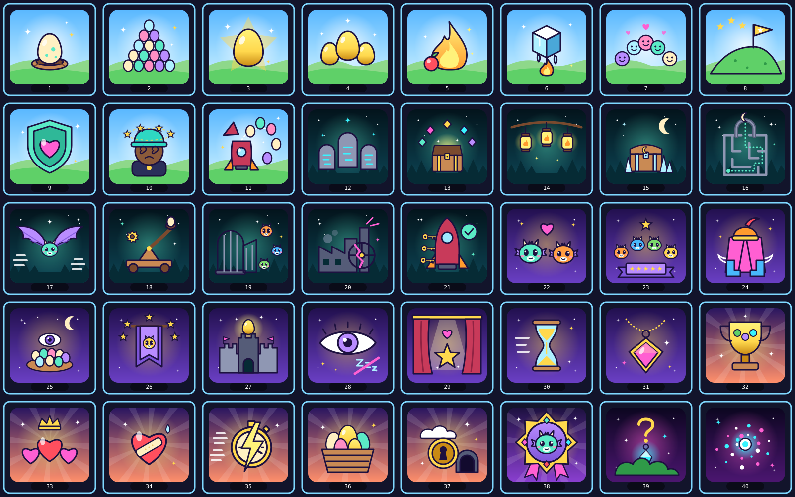

# Milestone drawings

The instructions for giving a milestone a drawing come first, as a guide for admins; then
[Pocket Dragon's 40 drawings](#pocket-dragons-drawings), ready to paste.

## Milestone drawings: a guide for admins

A milestone can carry a drawing. When an admin defines the milestone on a game's contract, the drawing is written on chain, and it becomes
part of the collectible a player holds when they mint the milestone. Pages show it too. Because of that, the platform never writes the
drawing you supply: it reads it as a strict subset of SVG, checks every element, attribute and value against an allow-list, and writes out
a fresh canonical copy. A drawing that uses anything outside the list is refused, not repaired, with the first problem it met.

The checks live in `packages/milestone-art` (`sanitizeDrawing`), and the staff step calls them before it builds any transaction
(`packages/game-admin/src/plan.ts`). A drawing is optional: a milestone defined without one is allowed. The complexity limits come from
configuration (`configs/game-admin.ts`); the byte limit is set per game (see [Limits](#limits)).

### Why `role` (or any attribute) is refused

"Attribute role is not allowed" means the `<svg>` tag, or another tag, carries an attribute that is not on the list below. `role`,
`aria-label` and `aria-*` are accessibility hints for web pages. They are not on the allow-list, so they are refused like any other unknown
attribute (`unknown-attribute`), even though they would be harmless in a browser. A milestone's name and description come from the game's
manifest, not from the drawing.

The check reports the first problem only. Fixing one and trying again can reveal the next. Use the checklist below to clear them all at
once.

### What a drawing may contain

One `<svg>` root with `xmlns="http://www.w3.org/2000/svg"` and a `viewBox` of four numbers, width and height above zero.

**Elements:** `svg` (the root only), `g`, `defs`, `path`, `rect`, `circle`, `ellipse`, `line`, `polygon`, `polyline`, `linearGradient`,
`radialGradient`, `stop`, `clipPath`.

**Attributes:** `clip-path`, `clip-rule`, `cx`, `cy`, `d`, `fill`, `fill-opacity`, `fill-rule`, `fx`, `fy`, `gradientTransform`,
`gradientUnits`, `height`, `id`, `offset`, `opacity`, `points`, `preserveAspectRatio`, `r`, `rx`, `ry`, `spreadMethod`, `stop-color`,
`stop-opacity`, `stroke`, `stroke-dasharray`, `stroke-dashoffset`, `stroke-linecap`, `stroke-linejoin`, `stroke-miterlimit`,
`stroke-opacity`, `stroke-width`, `transform`, `viewBox`, `width`, `x`, `x1`, `x2`, `y`, `y1`, `y2`, and `xmlns` on the root.

Values must be exactly one of these shapes. Nothing is trimmed or rewritten.

- `fill` and `stroke`: `none`, a hex colour (`#rgb`, `#rgba`, `#rrggbb`, `#rrggbbaa`), or `url(#id)` pointing at a gradient in the same
  drawing. `stop-color` takes a hex colour only (not `none`, not `url`). Names such as `red` and functions such as `rgb(...)` are refused.
- `width`, `height`, `x`, `y`, `x1`, `x2`, `y1`, `y2`, `cx`, `cy`, `r`, `rx`, `ry`, `fx`, `fy` and `offset`: a number, with an optional
  `%`. `stroke-width`, `stroke-dashoffset` and `stroke-miterlimit`: a number only. `stroke-dasharray`: `none` or a list of numbers.
  `points`: a list of numbers.
- `transform` and `gradientTransform`: only `translate`, `scale`, `rotate`, `skewX`, `skewY` and `matrix`, with plain numbers.
- `id` and the id in `url(#id)`: a letter first, then letters, digits, `_` or `-`, at most 32 characters. An id may be used only once,
  and every `url(#id)` must point at an id that exists in the same drawing (`bad-reference` otherwise).
- Path data (`d`): only path letters, digits, signs, dots, commas and spaces.
- `opacity`, `fill-opacity`, `stroke-opacity` and `stop-opacity`: 0 to 1.
- `fill-rule` and `clip-rule`: `nonzero` or `evenodd`. `stroke-linecap`: `butt`, `round` or `square`. `stroke-linejoin`: `miter`,
  `round` or `bevel`. `gradientUnits`: `userSpaceOnUse` or `objectBoundingBox`. `spreadMethod`: `pad`, `reflect` or `repeat`.

The text itself is read as a strict subset of XML (`packages/milestone-art/src/xml.ts`): printable ASCII plus tab, newline and carriage
return; elements with quoted attributes (single or double quotes) and nothing between them but whitespace; no repeated attribute on one
element; no `<` or `&` inside a value.

### Limits

Four, all checked: bytes, elements, nesting depth and the length of one attribute value.

- Bytes are the game's own limit: the drawing size the game's contract was created with, which cannot exceed the platform ceiling
  (`maxDrawingBytes` in `configs/rewards-policy.ts`). The size is measured on what you supply and again on the cleaned copy.
- Elements (the root included), depth (the root is depth 1) and attribute length come from `drawingLimits` in `configs/game-admin.ts`.

Read the numbers from those files rather than from this page.

### What is refused

| You have                                                                | Do this instead                                                                          |
| ----------------------------------------------------------------------- | ---------------------------------------------------------------------------------------- |
| `role`, `aria-label`, any `aria-*`, `class`, `style`, `data-*`          | Remove them. They are not drawing (`unknown-attribute`).                                 |
| `<?xml ...?>`, `<!DOCTYPE>`, comments (`<!-- -->`), CDATA               | Delete them. Design tools add them on export (`forbidden-markup`).                       |
| Prefixed names: `xlink:href`, `xmlns:xlink`, `inkscape:*`, `sodipodi:*` | Delete them. A name may hold only letters, digits and `-`, so these fail as malformed.   |
| `<use href="#shape"/>`, `href`                                          | Write the shape out where it is used. Links and references to other content are refused. |
| `<text>`, `<tspan>`                                                     | Convert text to outlines (paths). Fonts are not on chain.                                |
| `<image>`, `<a>`, `<script>`, `<style>`, `<animate*>`, filters          | Not allowed. Use shapes and gradients only.                                              |
| Colour names, `rgb(...)`, `hsl(...)`, `currentColor`                    | Use a hex colour.                                                                        |
| Units such as `px`, `em`, `pt` on `width`, `height`, `x`, `y`           | Use plain numbers (a `%` is the only suffix accepted, and not on `stroke-width`).        |
| An id used twice                                                        | Make each id unique (`bad-reference`).                                                   |
| Text between elements, an unquoted attribute value                      | Not valid in this subset (`malformed`).                                                  |
| A second `<svg>` inside the drawing                                     | One `<svg>` only. Use `<g>` to group.                                                    |
| An `xmlns` anywhere but the root                                        | Remove it.                                                                               |
| A `url(#id)` with no matching id                                        | Add the gradient or clip path, or remove the reference.                                  |

Refusal codes you may see: `too-large`, `too-complex`, `forbidden-character`, `forbidden-markup`, `malformed`, `missing-root`,
`unknown-element`, `unknown-attribute`, `bad-value`, `bad-reference`. The staff page shows "The drawing was refused." with the sentence
that names the element or attribute (for example "Attribute role is not allowed."); it does not show the code.

### Before you define the milestone

1. Export the drawing as plain SVG from your design tool (Figma, Inkscape, Illustrator). Use inline attributes, not CSS classes or style
   blocks, and keep ids short.
2. Convert strokes you rely on and all text to outlines. Flatten anything the tool leaves as a reusable symbol, `<use>` or filter.
3. Open the file in a text editor and clear the list in "What is refused": the XML declaration and comments at the top, the root's `role`
   and `aria-label`, every `href`, and every `<use>`, `<text>` and `<style>`.
4. Check the root has `xmlns` and a `viewBox`, that every `url(#id)` has a matching id, and that colours are hex.
5. Check the size against the limit. A drawing is also measured after cleaning, so leave some room.
6. Try it in the staff page's define-milestone step before you sign anything. A refused drawing stops before a transaction is built, so it
   costs nothing. A drawing that passes is written to the chain once: the platform refuses to define the same milestone again ("This
   milestone is already defined on the contract and cannot be defined again."), so check it before you sign.

### Who can define a milestone

Defining a milestone spends the game's auth token, which is held by the wallet that created the game's contract. Sign with that wallet.
See the staff page for the step and `packages/game-admin/README.md` for what each step checks.

## Pocket Dragon's drawings

The drawing each of the game's 40 milestones becomes on chain, in the order of the manifest (`configs/games/pocket-dragon.ts`) and of
the admin page's **Milestones** list. For each milestone, open **Add a drawing (optional)**, paste its code, then **Define**. A defined
milestone's drawing never changes, so these are a draft for the owners' sign-off along with the milestones (`DECISIONS.md`, item 3).



- **Size.** Each is 160 by 150 (`viewBox="0 0 160 150"`), the picture box of the frame the contract draws around a drawing
  (`contracts/templates/rewards-core/src/render/frame.rs`), above the edition plate.
- **Checked.** Each passes `sanitizeDrawing` (`packages/milestone-art`) with the limits in `configs/game-admin.ts` and a contract
  made to keep 4,096 bytes, and comes back byte for byte, so what is pasted is what is stored. The largest is 3,765 bytes, so
  the game's contract should be created to keep at least 4,096.
- **Drawn with** shapes, groups and gradients only, in Glitchy's colours, on a backdrop for each part of the game: Egg Hills by day, the
  Whispering Woods by moonlight, the Guild and the Castle in royal purple, the whole quest at sunset, and the secrets at night. No text:
  the platform refuses it in a drawing and shows the milestone's name beside the picture.

### 1. First egg (`first-egg`)

Catch an egg in Egg Hills. 1,760 bytes.

```xml
<svg xmlns="http://www.w3.org/2000/svg" viewBox="0 0 160 150"><defs><linearGradient id="a1" x1="0" y1="0" x2="0" y2="1"><stop offset="0" stop-color="#5ab8ff"/><stop offset="1" stop-color="#d4f5ff"/></linearGradient><radialGradient id="b1"><stop offset="0" stop-color="#ffffff" stop-opacity=".8"/><stop offset="1" stop-color="#ffffff" stop-opacity="0"/></radialGradient></defs><rect width="160" height="150" rx="18" fill="url(#a1)"/><circle cx="80" cy="72" r="66" fill="url(#b1)"/><path d="M0,112C30,98 56,98 84,110C108,120 136,104 160,100V132A18,18 0 0 1 142,150H18A18,18 0 0 1 0,132Z" fill="#8ed88a"/><path d="M0,124C44,112 96,118 160,126V132A18,18 0 0 1 142,150H18A18,18 0 0 1 0,132Z" fill="#5fd068"/><g stroke="#1d1140" stroke-width="3" stroke-linejoin="round" stroke-linecap="round"><ellipse cx="80" cy="108" rx="36" ry="12" fill="#c98a54"/><ellipse cx="80" cy="104" rx="27" ry="7" fill="#7a4a2e"/><path d="M80,48C96.8,48 104,72 104,85.2C104,99.6 93.2,108 80,108C66.8,108 56,99.6 56,85.2C56,72 63.2,48 80,48Z" fill="#fff0c2"/></g><circle cx="87.2" cy="79.2" r="4.2" fill="#5beac6"/><circle cx="74" cy="91.2" r="3" fill="#5beac6"/><circle cx="92" cy="94.8" r="2.4" fill="#5beac6"/><ellipse cx="69.8" cy="66" rx="4.2" ry="7.2" fill="#ffffff" opacity=".7" transform="rotate(25 69.8 66)"/><line x1="50" y1="112" x2="62" y2="106" stroke="#7a4a2e" stroke-width="2.5" stroke-linecap="round"/><line x1="98" y1="106" x2="110" y2="112" stroke="#7a4a2e" stroke-width="2.5" stroke-linecap="round"/><path d="M36,36Q36,44 44,44Q36,44 36,52Q36,44 28,44Q36,44 36,36Z" fill="#ffffff"/><path d="M124,44Q124,50 130,50Q124,50 124,56Q124,50 118,50Q124,50 124,44Z" fill="#ffd84d"/><path d="M114,22Q114,26 118,26Q114,26 114,30Q114,26 110,26Q114,26 114,22Z" fill="#ffffff"/></svg>
```

### 2. Egg mountain (`eggs-60`)

Catch 60 eggs in one run of Egg Hills. 1,984 bytes.

```xml
<svg xmlns="http://www.w3.org/2000/svg" viewBox="0 0 160 150"><defs><linearGradient id="a2" x1="0" y1="0" x2="0" y2="1"><stop offset="0" stop-color="#5ab8ff"/><stop offset="1" stop-color="#d4f5ff"/></linearGradient><radialGradient id="b2"><stop offset="0" stop-color="#ffffff" stop-opacity=".8"/><stop offset="1" stop-color="#ffffff" stop-opacity="0"/></radialGradient></defs><rect width="160" height="150" rx="18" fill="url(#a2)"/><circle cx="80" cy="72" r="66" fill="url(#b2)"/><path d="M0,112C30,98 56,98 84,110C108,120 136,104 160,100V132A18,18 0 0 1 142,150H18A18,18 0 0 1 0,132Z" fill="#8ed88a"/><path d="M0,124C44,112 96,118 160,126V132A18,18 0 0 1 142,150H18A18,18 0 0 1 0,132Z" fill="#5fd068"/><g stroke="#1d1140" stroke-width="2.5" stroke-linejoin="round" stroke-linecap="round"><ellipse cx="38" cy="112" rx="9.5" ry="11.5" fill="#fff0c2"/><ellipse cx="59" cy="112" rx="9.5" ry="11.5" fill="#5beac6"/><ellipse cx="80" cy="112" rx="9.5" ry="11.5" fill="#ff8fc4"/><ellipse cx="101" cy="112" rx="9.5" ry="11.5" fill="#b98cff"/><ellipse cx="122" cy="112" rx="9.5" ry="11.5" fill="#aef0ff"/><ellipse cx="48.5" cy="92" rx="9.5" ry="11.5" fill="#fff0c2"/><ellipse cx="69.5" cy="92" rx="9.5" ry="11.5" fill="#5beac6"/><ellipse cx="90.5" cy="92" rx="9.5" ry="11.5" fill="#ff8fc4"/><ellipse cx="111.5" cy="92" rx="9.5" ry="11.5" fill="#b98cff"/><ellipse cx="59" cy="72" rx="9.5" ry="11.5" fill="#aef0ff"/><ellipse cx="80" cy="72" rx="9.5" ry="11.5" fill="#fff0c2"/><ellipse cx="101" cy="72" rx="9.5" ry="11.5" fill="#5beac6"/><ellipse cx="69.5" cy="52" rx="9.5" ry="11.5" fill="#ff8fc4"/><ellipse cx="90.5" cy="52" rx="9.5" ry="11.5" fill="#b98cff"/><ellipse cx="80" cy="32" rx="9.5" ry="11.5" fill="#aef0ff"/></g><path d="M28,33Q28,40 35,40Q28,40 28,47Q28,40 21,40Q28,40 28,33Z" fill="#ffffff"/><path d="M132,30Q132,36 138,36Q132,36 132,42Q132,36 126,36Q132,36 132,30Z" fill="#ffd84d"/><path d="M126,66Q126,70 130,70Q126,70 126,74Q126,70 122,70Q126,70 126,66Z" fill="#ffffff"/></svg>
```

### 3. Golden egg (`golden-egg`)

Catch a golden egg in Egg Hills. 1,653 bytes.

```xml
<svg xmlns="http://www.w3.org/2000/svg" viewBox="0 0 160 150"><defs><linearGradient id="a3" x1="0" y1="0" x2="0" y2="1"><stop offset="0" stop-color="#5ab8ff"/><stop offset="1" stop-color="#d4f5ff"/></linearGradient><radialGradient id="b3"><stop offset="0" stop-color="#ffffff" stop-opacity=".8"/><stop offset="1" stop-color="#ffffff" stop-opacity="0"/></radialGradient><linearGradient id="e3" x1="0" y1="0" x2="0" y2="1"><stop offset="0" stop-color="#fff27a"/><stop offset="0.6" stop-color="#ffd84d"/><stop offset="1" stop-color="#c98a14"/></linearGradient></defs><rect width="160" height="150" rx="18" fill="url(#a3)"/><circle cx="80" cy="72" r="66" fill="url(#b3)"/><path d="M0,112C30,98 56,98 84,110C108,120 136,104 160,100V132A18,18 0 0 1 142,150H18A18,18 0 0 1 0,132Z" fill="#8ed88a"/><path d="M0,124C44,112 96,118 160,126V132A18,18 0 0 1 142,150H18A18,18 0 0 1 0,132Z" fill="#5fd068"/><path d="M80,14L97.6,49.7L137.1,55.5L108.5,83.3L115.3,122.5L80,104L44.7,122.5L51.5,83.3L22.9,55.5L62.4,49.7Z" fill="#ffd84d" opacity=".45"/><g stroke="#1d1140" stroke-width="3" stroke-linejoin="round" stroke-linecap="round"><path d="M80,39C100.7,39 109.6,68.6 109.6,84.9C109.6,102.6 96.3,113 80,113C63.7,113 50.4,102.6 50.4,84.9C50.4,68.6 59.3,39 80,39Z" fill="url(#e3)"/></g><ellipse cx="67.4" cy="61.2" rx="5.2" ry="8.9" fill="#ffffff" opacity=".8" transform="rotate(25 67.4 61.2)"/><path d="M38,26Q38,34 46,34Q38,34 38,42Q38,34 30,34Q38,34 38,26Z" fill="#ffffff"/><path d="M126,35Q126,42 133,42Q126,42 126,49Q126,42 119,42Q126,42 126,35Z" fill="#ffffff"/><path d="M120,99Q120,104 125,104Q120,104 120,109Q120,104 115,104Q120,104 120,99Z" fill="#ffd84d"/></svg>
```

### 4. Golden trio (`golden-eggs-3`)

Catch 3 golden eggs in one run of Egg Hills. 2,006 bytes.

```xml
<svg xmlns="http://www.w3.org/2000/svg" viewBox="0 0 160 150"><defs><linearGradient id="a4" x1="0" y1="0" x2="0" y2="1"><stop offset="0" stop-color="#5ab8ff"/><stop offset="1" stop-color="#d4f5ff"/></linearGradient><radialGradient id="b4"><stop offset="0" stop-color="#ffffff" stop-opacity=".8"/><stop offset="1" stop-color="#ffffff" stop-opacity="0"/></radialGradient><linearGradient id="e4" x1="0" y1="0" x2="0" y2="1"><stop offset="0" stop-color="#fff27a"/><stop offset="0.6" stop-color="#ffd84d"/><stop offset="1" stop-color="#c98a14"/></linearGradient></defs><rect width="160" height="150" rx="18" fill="url(#a4)"/><circle cx="80" cy="72" r="66" fill="url(#b4)"/><path d="M0,112C30,98 56,98 84,110C108,120 136,104 160,100V132A18,18 0 0 1 142,150H18A18,18 0 0 1 0,132Z" fill="#8ed88a"/><path d="M0,124C44,112 96,118 160,126V132A18,18 0 0 1 142,150H18A18,18 0 0 1 0,132Z" fill="#5fd068"/><g stroke="#1d1140" stroke-width="3" stroke-linejoin="round" stroke-linecap="round"><path d="M44,66C56.3,66 61.6,83.6 61.6,93.3C61.6,103.8 53.7,110 44,110C34.3,110 26.4,103.8 26.4,93.3C26.4,83.6 31.7,66 44,66Z" fill="url(#e4)"/><path d="M116,66C128.3,66 133.6,83.6 133.6,93.3C133.6,103.8 125.7,110 116,110C106.3,110 98.4,103.8 98.4,93.3C98.4,83.6 103.7,66 116,66Z" fill="url(#e4)"/><path d="M80,43C96.2,43 103.2,66.2 103.2,79C103.2,92.9 92.8,101 80,101C67.2,101 56.8,92.9 56.8,79C56.8,66.2 63.8,43 80,43Z" fill="url(#e4)"/></g><ellipse cx="36.5" cy="79.2" rx="3.1" ry="5.3" fill="#ffffff" opacity=".7" transform="rotate(25 36.5 79.2)"/><ellipse cx="108.5" cy="79.2" rx="3.1" ry="5.3" fill="#ffffff" opacity=".7" transform="rotate(25 108.5 79.2)"/><ellipse cx="70.1" cy="60.4" rx="4.1" ry="7" fill="#ffffff" opacity=".8" transform="rotate(25 70.1 60.4)"/><path d="M80,15Q80,22 87,22Q80,22 80,29Q80,22 73,22Q80,22 80,15Z" fill="#ffffff"/><path d="M28,43Q28,48 33,48Q28,48 28,53Q28,48 23,48Q28,48 28,43Z" fill="#ffffff"/><path d="M134,45Q134,50 139,50Q134,50 134,55Q134,50 129,50Q134,50 134,45Z" fill="#ffffff"/></svg>
```

### 5. First flame (`fire-breath`)

Eat the fire berry and breathe fire in Egg Hills. 1,810 bytes.

```xml
<svg xmlns="http://www.w3.org/2000/svg" viewBox="0 0 160 150"><defs><linearGradient id="a5" x1="0" y1="0" x2="0" y2="1"><stop offset="0" stop-color="#5ab8ff"/><stop offset="1" stop-color="#d4f5ff"/></linearGradient><radialGradient id="b5"><stop offset="0" stop-color="#ffffff" stop-opacity=".8"/><stop offset="1" stop-color="#ffffff" stop-opacity="0"/></radialGradient><linearGradient id="f5" x1="0" y1="0" x2="0" y2="1"><stop offset="0" stop-color="#fff27a"/><stop offset="1" stop-color="#ff9a2e"/></linearGradient></defs><rect width="160" height="150" rx="18" fill="url(#a5)"/><circle cx="80" cy="72" r="66" fill="url(#b5)"/><path d="M0,112C30,98 56,98 84,110C108,120 136,104 160,100V132A18,18 0 0 1 142,150H18A18,18 0 0 1 0,132Z" fill="#8ed88a"/><path d="M0,124C44,112 96,118 160,126V132A18,18 0 0 1 142,150H18A18,18 0 0 1 0,132Z" fill="#5fd068"/><g stroke="#1d1140" stroke-width="3" stroke-linejoin="round" stroke-linecap="round"><path d="M84,24C101.3,50.9 124.3,72 118.6,98.9C114.7,120 99.4,120 84,120C64.8,120 49.4,114.2 49.4,95C49.4,75.8 68.6,72 74.4,52.8C82.1,66.2 87.8,60.5 84,24Z" fill="url(#f5)"/></g><path d="M84,64C93.4,78.6 105.8,90 102.7,104.6C100.6,116 92.3,116 84,116C73.6,116 65.3,112.9 65.3,102.5C65.3,92.1 75.7,90 78.8,79.6C83,86.9 86.1,83.8 84,64Z" fill="#fff27a"/><g stroke="#1d1140" stroke-width="3" stroke-linejoin="round" stroke-linecap="round"><circle cx="48" cy="108" r="14" fill="#ff4f5e"/><path d="M48,94Q52,84 62,86Q58,96 48,94Z" fill="#5fd068"/></g><circle cx="43" cy="103" r="4" fill="#ffffff" opacity=".7"/><path d="M124,34Q124,40 130,40Q124,40 124,46Q124,40 118,40Q124,40 124,34Z" fill="#fff27a"/><path d="M36,49Q36,54 41,54Q36,54 36,59Q36,54 31,54Q36,54 36,49Z" fill="#ffffff"/><path d="M130,84Q130,88 134,88Q130,88 130,92Q130,88 126,88Q130,88 130,84Z" fill="#fff27a"/></svg>
```

### 6. Ice melter (`ice-melter`)

Melt 15 blocks of ice with fire in one run of Egg Hills. 1,887 bytes.

```xml
<svg xmlns="http://www.w3.org/2000/svg" viewBox="0 0 160 150"><defs><linearGradient id="a6" x1="0" y1="0" x2="0" y2="1"><stop offset="0" stop-color="#5ab8ff"/><stop offset="1" stop-color="#d4f5ff"/></linearGradient><radialGradient id="b6"><stop offset="0" stop-color="#ffffff" stop-opacity=".8"/><stop offset="1" stop-color="#ffffff" stop-opacity="0"/></radialGradient></defs><rect width="160" height="150" rx="18" fill="url(#a6)"/><circle cx="80" cy="72" r="66" fill="url(#b6)"/><path d="M0,112C30,98 56,98 84,110C108,120 136,104 160,100V132A18,18 0 0 1 142,150H18A18,18 0 0 1 0,132Z" fill="#8ed88a"/><path d="M0,124C44,112 96,118 160,126V132A18,18 0 0 1 142,150H18A18,18 0 0 1 0,132Z" fill="#5fd068"/><g stroke="#1d1140" stroke-width="3" stroke-linejoin="round" stroke-linecap="round"><path d="M52,46L80,32L108,46L80,60Z" fill="#ffffff"/><path d="M52,46V82L80,96V60Z" fill="#aef0ff"/><path d="M108,46V82L80,96V60Z" fill="#4aa8d8"/><path d="M62,90Q60,100 64,104Q68,100 66,92Z" fill="#aef0ff"/><path d="M96,92Q94,104 98,108Q102,104 100,94Z" fill="#aef0ff"/></g><path d="M60,54L66,57V72" fill="none" stroke="#ffffff" stroke-width="3" stroke-linecap="round" opacity=".8"/><g stroke="#1d1140" stroke-width="3" stroke-linejoin="round" stroke-linecap="round"><path d="M80,96C86.5,106.1 95.1,114 93,124.1C91.5,132 85.8,132 80,132C72.8,132 67,129.8 67,122.6C67,115.4 74.2,114 76.4,106.8C79.3,111.8 81.4,109.7 80,96Z" fill="#ff9a2e"/></g><path d="M80,112C83.2,117 87.6,121 86.5,126C85.8,130 82.9,130 80,130C76.4,130 73.5,128.9 73.5,125.3C73.5,121.7 77.1,121 78.2,117.4C79.6,119.9 80.7,118.8 80,112Z" fill="#fff27a"/><path d="M34,28Q34,34 40,34Q34,34 34,40Q34,34 28,34Q34,34 34,28Z" fill="#ffffff"/><path d="M128,25Q128,30 133,30Q128,30 128,35Q128,30 123,30Q128,30 128,25Z" fill="#ffffff"/><path d="M130,108Q130,112 134,112Q130,112 130,116Q130,112 126,112Q130,112 130,108Z" fill="#fff27a"/></svg>
```

### 7. Cheer squad (`cheer-5`)

Cheer up 5 gloomlings in one run of Egg Hills. 2,891 bytes.

```xml
<svg xmlns="http://www.w3.org/2000/svg" viewBox="0 0 160 150"><defs><linearGradient id="a7" x1="0" y1="0" x2="0" y2="1"><stop offset="0" stop-color="#5ab8ff"/><stop offset="1" stop-color="#d4f5ff"/></linearGradient><radialGradient id="b7"><stop offset="0" stop-color="#ffffff" stop-opacity=".8"/><stop offset="1" stop-color="#ffffff" stop-opacity="0"/></radialGradient></defs><rect width="160" height="150" rx="18" fill="url(#a7)"/><circle cx="80" cy="72" r="66" fill="url(#b7)"/><path d="M0,112C30,98 56,98 84,110C108,120 136,104 160,100V132A18,18 0 0 1 142,150H18A18,18 0 0 1 0,132Z" fill="#8ed88a"/><path d="M0,124C44,112 96,118 160,126V132A18,18 0 0 1 142,150H18A18,18 0 0 1 0,132Z" fill="#5fd068"/><g stroke="#1d1140" stroke-width="2.5" stroke-linejoin="round" stroke-linecap="round"><circle cx="32" cy="98" r="14" fill="#b98cff"/></g><circle cx="27.2" cy="95.5" r="2" fill="#1d1140"/><circle cx="36.8" cy="95.5" r="2" fill="#1d1140"/><g stroke="#1d1140" stroke-width="2" stroke-linejoin="round" stroke-linecap="round"><path d="M27,100.8Q32,106.7 37,100.8" fill="none"/></g><g stroke="#1d1140" stroke-width="2.5" stroke-linejoin="round" stroke-linecap="round"><circle cx="56" cy="76" r="14" fill="#aef0ff"/></g><circle cx="51.2" cy="73.5" r="2" fill="#1d1140"/><circle cx="60.8" cy="73.5" r="2" fill="#1d1140"/><g stroke="#1d1140" stroke-width="2" stroke-linejoin="round" stroke-linecap="round"><path d="M51,78.8Q56,84.7 61,78.8" fill="none"/></g><g stroke="#1d1140" stroke-width="2.5" stroke-linejoin="round" stroke-linecap="round"><circle cx="80" cy="66" r="15" fill="#ff8fc4"/></g><circle cx="74.9" cy="63.3" r="2.1" fill="#1d1140"/><circle cx="85.1" cy="63.3" r="2.1" fill="#1d1140"/><g stroke="#1d1140" stroke-width="2" stroke-linejoin="round" stroke-linecap="round"><path d="M74.6,69Q80,75.3 85.4,69" fill="none"/></g><g stroke="#1d1140" stroke-width="2.5" stroke-linejoin="round" stroke-linecap="round"><circle cx="104" cy="76" r="14" fill="#5beac6"/></g><circle cx="99.2" cy="73.5" r="2" fill="#1d1140"/><circle cx="108.8" cy="73.5" r="2" fill="#1d1140"/><g stroke="#1d1140" stroke-width="2" stroke-linejoin="round" stroke-linecap="round"><path d="M99,78.8Q104,84.7 109,78.8" fill="none"/></g><g stroke="#1d1140" stroke-width="2.5" stroke-linejoin="round" stroke-linecap="round"><circle cx="128" cy="98" r="14" fill="#fff0c2"/></g><circle cx="123.2" cy="95.5" r="2" fill="#1d1140"/><circle cx="132.8" cy="95.5" r="2" fill="#1d1140"/><g stroke="#1d1140" stroke-width="2" stroke-linejoin="round" stroke-linecap="round"><path d="M123,100.8Q128,106.7 133,100.8" fill="none"/></g><path d="M80,40.7C70.1,34.3 72,25.2 80,30.2C88,25.2 89.9,34.3 80,40.7Z" fill="#ff5fd2"/><path d="M44,50.2C37.8,46.2 39,40.5 44,43.6C49,40.5 50.2,46.2 44,50.2Z" fill="#ff5fd2" opacity=".8"/><path d="M116,50.2C109.8,46.2 111,40.5 116,43.6C121,40.5 122.2,46.2 116,50.2Z" fill="#ff5fd2" opacity=".8"/></svg>
```

### 8. Egg Hills cleared (`hills-clear`)

Clear all three stages of Egg Hills. 1,681 bytes.

```xml
<svg xmlns="http://www.w3.org/2000/svg" viewBox="0 0 160 150"><defs><linearGradient id="a8" x1="0" y1="0" x2="0" y2="1"><stop offset="0" stop-color="#5ab8ff"/><stop offset="1" stop-color="#d4f5ff"/></linearGradient><radialGradient id="b8"><stop offset="0" stop-color="#ffffff" stop-opacity=".8"/><stop offset="1" stop-color="#ffffff" stop-opacity="0"/></radialGradient></defs><rect width="160" height="150" rx="18" fill="url(#a8)"/><circle cx="80" cy="72" r="66" fill="url(#b8)"/><path d="M0,112C30,98 56,98 84,110C108,120 136,104 160,100V132A18,18 0 0 1 142,150H18A18,18 0 0 1 0,132Z" fill="#8ed88a"/><path d="M0,124C44,112 96,118 160,126V132A18,18 0 0 1 142,150H18A18,18 0 0 1 0,132Z" fill="#5fd068"/><g stroke="#1d1140" stroke-width="3" stroke-linejoin="round" stroke-linecap="round"><path d="M10,128C38,84 70,74 96,74C122,74 140,96 152,128Z" fill="#5fd068"/><line x1="96" y1="76" x2="96" y2="30" stroke="#1d1140" stroke-width="3" stroke-linecap="round"/><path d="M98,30L134,40L98,52Z" fill="#ffd84d"/></g><polygon points="110,35 111.5,38.9 115.7,39.1 112.5,41.8 113.5,45.9 110,43.6 106.5,45.9 107.5,41.8 104.3,39.1 108.5,38.9" fill="#ffffff"/><polygon points="30,26 32.1,31.1 37.6,31.5 33.4,35.1 34.7,40.5 30,37.6 25.3,40.5 26.6,35.1 22.4,31.5 27.9,31.1" fill="#ffd84d"/><polygon points="52,14 54.1,19.1 59.6,19.5 55.4,23.1 56.7,28.5 52,25.6 47.3,28.5 48.6,23.1 44.4,19.5 49.9,19.1" fill="#ffd84d"/><polygon points="74,24 76.1,29.1 81.6,29.5 77.4,33.1 78.7,38.5 74,35.6 69.3,38.5 70.6,33.1 66.4,29.5 71.9,29.1" fill="#ffd84d"/><circle cx="60" cy="102" r="3" fill="#2f9a48"/><circle cx="120" cy="108" r="3" fill="#2f9a48"/><circle cx="84" cy="116" r="2.5" fill="#2f9a48"/></svg>
```

### 9. Not a bump (`hills-no-bumps`)

Clear all three stages of Egg Hills without losing a heart. 1,491 bytes.

```xml
<svg xmlns="http://www.w3.org/2000/svg" viewBox="0 0 160 150"><defs><linearGradient id="a9" x1="0" y1="0" x2="0" y2="1"><stop offset="0" stop-color="#5ab8ff"/><stop offset="1" stop-color="#d4f5ff"/></linearGradient><radialGradient id="b9"><stop offset="0" stop-color="#ffffff" stop-opacity=".8"/><stop offset="1" stop-color="#ffffff" stop-opacity="0"/></radialGradient></defs><rect width="160" height="150" rx="18" fill="url(#a9)"/><circle cx="80" cy="72" r="66" fill="url(#b9)"/><path d="M0,112C30,98 56,98 84,110C108,120 136,104 160,100V132A18,18 0 0 1 142,150H18A18,18 0 0 1 0,132Z" fill="#8ed88a"/><path d="M0,124C44,112 96,118 160,126V132A18,18 0 0 1 142,150H18A18,18 0 0 1 0,132Z" fill="#5fd068"/><g stroke="#1d1140" stroke-width="3" stroke-linejoin="round" stroke-linecap="round"><path d="M80,22L124,36V72C124,100 104,118 80,128C56,118 36,100 36,72V36Z" fill="#5beac6"/><path d="M80,34L112,44V72C112,94 98,108 80,116C62,108 48,94 48,72V44Z" fill="#2fb898"/></g><g stroke="#1d1140" stroke-width="3" stroke-linejoin="round" stroke-linecap="round"><path d="M80,97.3C51.5,78.9 57,52.7 80,67C103,52.7 108.5,78.9 80,97.3Z" fill="#ff5fd2"/></g><ellipse cx="68" cy="66" rx="5" ry="7" fill="#ffffff" opacity=".7"/><path d="M136,27Q136,34 143,34Q136,34 136,41Q136,34 129,34Q136,34 136,27Z" fill="#ffffff"/><path d="M26,41Q26,46 31,46Q26,46 26,51Q26,46 21,46Q26,46 26,41Z" fill="#ffffff"/><path d="M132,100Q132,104 136,104Q132,104 132,108Q132,104 128,104Q132,104 132,100Z" fill="#ffd84d"/></svg>
```

### 10. Guards go home (`hills-guards`)

Cheer up 4 of DeFu's security guards in one run. 2,266 bytes.

```xml
<svg xmlns="http://www.w3.org/2000/svg" viewBox="0 0 160 150"><defs><linearGradient id="a10" x1="0" y1="0" x2="0" y2="1"><stop offset="0" stop-color="#5ab8ff"/><stop offset="1" stop-color="#d4f5ff"/></linearGradient><radialGradient id="b10"><stop offset="0" stop-color="#ffffff" stop-opacity=".8"/><stop offset="1" stop-color="#ffffff" stop-opacity="0"/></radialGradient></defs><rect width="160" height="150" rx="18" fill="url(#a10)"/><circle cx="80" cy="72" r="66" fill="url(#b10)"/><path d="M0,112C30,98 56,98 84,110C108,120 136,104 160,100V132A18,18 0 0 1 142,150H18A18,18 0 0 1 0,132Z" fill="#8ed88a"/><path d="M0,124C44,112 96,118 160,126V132A18,18 0 0 1 142,150H18A18,18 0 0 1 0,132Z" fill="#5fd068"/><g stroke="#1d1140" stroke-width="3" stroke-linejoin="round" stroke-linecap="round"><rect x="46" y="104" width="68" height="30" rx="10" fill="#2a2f5a"/><circle cx="80" cy="84" r="28" fill="#8a5a3a"/><path d="M50,70Q50,40 80,40Q110,40 110,70Z" fill="#2ed8c3"/><rect x="44" y="66" width="72" height="9" rx="4.5" fill="#2ed8c3"/></g><circle cx="80" cy="118" r="5" fill="#ffd84d"/><path d="M68,80m-6,0a6,6 0 1 1 6,6a3,3 0 1 1 -3,-3" fill="none" stroke="#1d1140" stroke-width="2.5" stroke-linecap="round"/><path d="M92,80m-6,0a6,6 0 1 1 6,6a3,3 0 1 1 -3,-3" fill="none" stroke="#1d1140" stroke-width="2.5" stroke-linecap="round"/><g stroke="#1d1140" stroke-width="2.5" stroke-linejoin="round" stroke-linecap="round"><path d="M72,98Q80,92 88,98" fill="none"/></g><ellipse cx="80" cy="50" rx="44" ry="12" fill="none" stroke="#ffd84d" stroke-width="2" stroke-dasharray="5 5" opacity=".8"/><polygon points="36,42 38.1,47.2 43.6,47.5 39.3,51.1 40.7,56.5 36,53.5 31.3,56.5 32.7,51.1 28.4,47.5 33.9,47.2" fill="#ffd84d" stroke="#1d1140" stroke-width="1.5"/><polygon points="62,30 64.1,35.2 69.6,35.5 65.3,39.1 66.7,44.5 62,41.5 57.3,44.5 58.7,39.1 54.4,35.5 59.9,35.2" fill="#ffd84d" stroke="#1d1140" stroke-width="1.5"/><polygon points="100,30 102.1,35.2 107.6,35.5 103.3,39.1 104.7,44.5 100,41.5 95.3,44.5 96.7,39.1 92.4,35.5 97.9,35.2" fill="#ffd84d" stroke="#1d1140" stroke-width="1.5"/><polygon points="124,42 126.1,47.2 131.6,47.5 127.3,51.1 128.7,56.5 124,53.5 119.3,56.5 120.7,51.1 116.4,47.5 121.9,47.2" fill="#ffd84d" stroke="#1d1140" stroke-width="1.5"/></svg>
```

### 11. Egg rescue (`hills-rocket-eggs`)

Catch 10 eggs freed from DeFu's egg rocket. 1,956 bytes.

```xml
<svg xmlns="http://www.w3.org/2000/svg" viewBox="0 0 160 150"><defs><linearGradient id="a11" x1="0" y1="0" x2="0" y2="1"><stop offset="0" stop-color="#5ab8ff"/><stop offset="1" stop-color="#d4f5ff"/></linearGradient><radialGradient id="b11"><stop offset="0" stop-color="#ffffff" stop-opacity=".8"/><stop offset="1" stop-color="#ffffff" stop-opacity="0"/></radialGradient></defs><rect width="160" height="150" rx="18" fill="url(#a11)"/><circle cx="80" cy="72" r="66" fill="url(#b11)"/><path d="M0,112C30,98 56,98 84,110C108,120 136,104 160,100V132A18,18 0 0 1 142,150H18A18,18 0 0 1 0,132Z" fill="#8ed88a"/><path d="M0,124C44,112 96,118 160,126V132A18,18 0 0 1 142,150H18A18,18 0 0 1 0,132Z" fill="#5fd068"/><path d="M66,62Q86,30 120,40" fill="none" stroke="#ffffff" stroke-width="3" stroke-dasharray="3 6" stroke-linecap="round" opacity=".9"/><g stroke="#1d1140" stroke-width="3" stroke-linejoin="round" stroke-linecap="round"><path d="M48,96L32,122H48ZM84,96L100,122H84Z" fill="#ff9a2e"/><path d="M48,64H84C87,80 87,96 84,114H48C45,96 45,80 48,64Z" fill="#c83a5a"/><circle cx="66" cy="86" r="9" fill="#9fe8ff"/><rect x="54" y="114" width="24" height="7" rx="2" fill="#555c78"/><polygon points="30,52 50,26 60,50" fill="#c83a5a"/></g><ellipse cx="62" cy="82" rx="3" ry="4" fill="#ffffff" opacity=".8"/><g stroke="#1d1140" stroke-width="2.5" stroke-linejoin="round" stroke-linecap="round"><ellipse cx="84" cy="44" rx="9" ry="11.5" fill="#fff0c2"/><ellipse cx="104" cy="28" rx="9" ry="11.5" fill="#5beac6"/><ellipse cx="126" cy="40" rx="9" ry="11.5" fill="#ff8fc4"/><ellipse cx="136" cy="70" rx="9" ry="11.5" fill="#fff0c2"/><ellipse cx="118" cy="98" rx="9" ry="11.5" fill="#b98cff"/></g><path d="M140,13Q140,18 145,18Q140,18 140,23Q140,18 135,18Q140,18 140,13Z" fill="#ffffff"/><path d="M28,71Q28,76 33,76Q28,76 28,81Q28,76 23,76Q28,76 28,71Z" fill="#ffd84d"/><path d="M110,63Q110,66 113,66Q110,66 110,69Q110,66 107,66Q110,66 110,63Z" fill="#ffffff"/></svg>
```

### 12. Three clues (`woods-all-clues`)

Read all three clue stones in one run of the Whispering Woods. 1,912 bytes.

```xml
<svg xmlns="http://www.w3.org/2000/svg" viewBox="0 0 160 150"><defs><linearGradient id="a12" x1="0" y1="0" x2="0" y2="1"><stop offset="0" stop-color="#03141c"/><stop offset="1" stop-color="#0d4555"/></linearGradient><radialGradient id="b12"><stop offset="0" stop-color="#5beac6" stop-opacity=".4"/><stop offset="1" stop-color="#5beac6" stop-opacity="0"/></radialGradient></defs><rect width="160" height="150" rx="18" fill="url(#a12)"/><circle cx="80" cy="72" r="66" fill="url(#b12)"/><circle cx="22" cy="22" r="1.5" fill="#ffffff"/><circle cx="140" cy="30" r="1.2" fill="#ffffff"/><circle cx="118" cy="14" r="1" fill="#ffffff"/><circle cx="34" cy="52" r="1" fill="#ffffff"/><path d="M0,128L9,110L18,128L28,102L40,128L50,114L58,128H102L110,112L120,128L132,100L144,128L152,112L160,124V132A18,18 0 0 1 142,150H18A18,18 0 0 1 0,132Z" fill="#062b35"/><g stroke="#1d1140" stroke-width="3" stroke-linejoin="round" stroke-linecap="round"><path d="M22,121V87A16,16 0 0 1 54,87V121Z" fill="#8f97b3"/></g><path d="M31,92H45M31,101H41.8M34.2,110H45" fill="none" stroke="#38f3ff" stroke-width="3" stroke-linecap="round"/><g stroke="#1d1140" stroke-width="3" stroke-linejoin="round" stroke-linecap="round"><path d="M106,121V87A16,16 0 0 1 138,87V121Z" fill="#8f97b3"/></g><path d="M115,92H129M115,101H125.8M118.2,110H129" fill="none" stroke="#38f3ff" stroke-width="3" stroke-linecap="round"/><g stroke="#1d1140" stroke-width="3" stroke-linejoin="round" stroke-linecap="round"><path d="M61,117V66A19,19 0 0 1 99,66V117Z" fill="#8f97b3"/></g><path d="M71.6,76.4H88.4M71.6,89H84.6M75.4,101.6H88.4" fill="none" stroke="#38f3ff" stroke-width="3" stroke-linecap="round"/><path d="M80,15Q80,22 87,22Q80,22 80,29Q80,22 73,22Q80,22 80,15Z" fill="#38f3ff"/><path d="M30,48Q30,52 34,52Q30,52 30,56Q30,52 26,52Q30,52 30,48Z" fill="#38f3ff"/><path d="M132,46Q132,50 136,50Q132,50 132,54Q132,50 128,50Q132,50 132,46Z" fill="#38f3ff"/></svg>
```

### 13. Treasure hunter (`woods-chests-5`)

Open all 5 treasure chests in one run of the Whispering Woods. 2,435 bytes.

```xml
<svg xmlns="http://www.w3.org/2000/svg" viewBox="0 0 160 150"><defs><linearGradient id="a13" x1="0" y1="0" x2="0" y2="1"><stop offset="0" stop-color="#03141c"/><stop offset="1" stop-color="#0d4555"/></linearGradient><radialGradient id="b13"><stop offset="0" stop-color="#5beac6" stop-opacity=".4"/><stop offset="1" stop-color="#5beac6" stop-opacity="0"/></radialGradient><radialGradient id="c13"><stop offset="0" stop-color="#fff27a" stop-opacity=".9"/><stop offset="1" stop-color="#fff27a" stop-opacity="0"/></radialGradient></defs><rect width="160" height="150" rx="18" fill="url(#a13)"/><circle cx="80" cy="72" r="66" fill="url(#b13)"/><circle cx="22" cy="22" r="1.5" fill="#ffffff"/><circle cx="140" cy="30" r="1.2" fill="#ffffff"/><circle cx="118" cy="14" r="1" fill="#ffffff"/><circle cx="34" cy="52" r="1" fill="#ffffff"/><path d="M0,128L9,110L18,128L28,102L40,128L50,114L58,128H102L110,112L120,128L132,100L144,128L152,112L160,124V132A18,18 0 0 1 142,150H18A18,18 0 0 1 0,132Z" fill="#062b35"/><circle cx="80" cy="82" r="34" fill="url(#c13)"/><g stroke="#1d1140" stroke-width="2.4" stroke-linejoin="round" stroke-linecap="round"><rect x="50" y="92" width="60" height="33" rx="3" fill="#c98a54"/><path d="M50,92L54.2,72.2L105.8,72.2L110,92Z" fill="#7a4a2e"/><rect x="60.2" y="92" width="6" height="33" fill="#ffd84d"/><rect x="93.8" y="92" width="6" height="33" fill="#ffd84d"/><rect x="75.2" y="88.4" width="9.6" height="12" rx="1.8" fill="#ffd84d"/></g><circle cx="80" cy="95" r="1.5" fill="#1d1140"/><g stroke="#1d1140" stroke-width="2.5" stroke-linejoin="round" stroke-linecap="round"><polygon points="30,57 38,66 30,75 22,66" fill="#5beac6"/></g><g stroke="#1d1140" stroke-width="2.5" stroke-linejoin="round" stroke-linecap="round"><polygon points="46,33 54,42 46,51 38,42" fill="#ff5fd2"/></g><g stroke="#1d1140" stroke-width="2.5" stroke-linejoin="round" stroke-linecap="round"><polygon points="80,21 88,30 80,39 72,30" fill="#ffd84d"/></g><g stroke="#1d1140" stroke-width="2.5" stroke-linejoin="round" stroke-linecap="round"><polygon points="114,33 122,42 114,51 106,42" fill="#38f3ff"/></g><g stroke="#1d1140" stroke-width="2.5" stroke-linejoin="round" stroke-linecap="round"><polygon points="130,57 138,66 130,75 122,66" fill="#b98cff"/></g><path d="M62,60Q62,64 66,64Q62,64 62,68Q62,64 58,64Q62,64 62,60Z" fill="#ffffff"/><path d="M100,58Q100,62 104,62Q100,62 100,66Q100,62 96,62Q100,62 100,58Z" fill="#ffffff"/></svg>
```

### 14. Lantern lighter (`woods-lanterns`)

Light all 3 lanterns with fire in one run of the Whispering Woods. 3,076 bytes.

```xml
<svg xmlns="http://www.w3.org/2000/svg" viewBox="0 0 160 150"><defs><linearGradient id="a14" x1="0" y1="0" x2="0" y2="1"><stop offset="0" stop-color="#03141c"/><stop offset="1" stop-color="#0d4555"/></linearGradient><radialGradient id="b14"><stop offset="0" stop-color="#5beac6" stop-opacity=".4"/><stop offset="1" stop-color="#5beac6" stop-opacity="0"/></radialGradient><radialGradient id="c14"><stop offset="0" stop-color="#ffd84d" stop-opacity=".8"/><stop offset="1" stop-color="#ffd84d" stop-opacity="0"/></radialGradient></defs><rect width="160" height="150" rx="18" fill="url(#a14)"/><circle cx="80" cy="72" r="66" fill="url(#b14)"/><circle cx="22" cy="22" r="1.5" fill="#ffffff"/><circle cx="140" cy="30" r="1.2" fill="#ffffff"/><circle cx="118" cy="14" r="1" fill="#ffffff"/><circle cx="34" cy="52" r="1" fill="#ffffff"/><path d="M0,128L9,110L18,128L28,102L40,128L50,114L58,128H102L110,112L120,128L132,100L144,128L152,112L160,124V132A18,18 0 0 1 142,150H18A18,18 0 0 1 0,132Z" fill="#062b35"/><path d="M10,36Q80,16 150,36" fill="none" stroke="#7a4a2e" stroke-width="5" stroke-linecap="round"/><circle cx="38" cy="66" r="22" fill="url(#c14)"/><g stroke="#1d1140" stroke-width="2.5" stroke-linejoin="round" stroke-linecap="round"><line x1="38" y1="36" x2="38" y2="48" stroke="#1d1140" stroke-width="2" stroke-linecap="round"/><rect x="30" y="48" width="16" height="6" rx="2" fill="#7a4a2e"/><rect x="27" y="54" width="22" height="26" rx="6" fill="#fff27a"/><rect x="30" y="80" width="16" height="5" rx="2" fill="#7a4a2e"/></g><path d="M38,60C40.5,63.9 43.9,67 43,70.9C42.5,74 40.2,74 38,74C35.2,74 33,73.2 33,70.4C33,67.6 35.8,67 36.6,64.2C37.7,66.2 38.6,65.3 38,60Z" fill="#ff9a2e"/><circle cx="80" cy="56" r="22" fill="url(#c14)"/><g stroke="#1d1140" stroke-width="2.5" stroke-linejoin="round" stroke-linecap="round"><line x1="80" y1="26" x2="80" y2="38" stroke="#1d1140" stroke-width="2" stroke-linecap="round"/><rect x="72" y="38" width="16" height="6" rx="2" fill="#7a4a2e"/><rect x="69" y="44" width="22" height="26" rx="6" fill="#fff27a"/><rect x="72" y="70" width="16" height="5" rx="2" fill="#7a4a2e"/></g><path d="M80,50C82.5,53.9 85.9,57 85,60.9C84.5,64 82.2,64 80,64C77.2,64 75,63.2 75,60.4C75,57.6 77.8,57 78.6,54.2C79.7,56.2 80.6,55.3 80,50Z" fill="#ff9a2e"/><circle cx="122" cy="66" r="22" fill="url(#c14)"/><g stroke="#1d1140" stroke-width="2.5" stroke-linejoin="round" stroke-linecap="round"><line x1="122" y1="36" x2="122" y2="48" stroke="#1d1140" stroke-width="2" stroke-linecap="round"/><rect x="114" y="48" width="16" height="6" rx="2" fill="#7a4a2e"/><rect x="111" y="54" width="22" height="26" rx="6" fill="#fff27a"/><rect x="114" y="80" width="16" height="5" rx="2" fill="#7a4a2e"/></g><path d="M122,60C124.5,63.9 127.9,67 127,70.9C126.5,74 124.2,74 122,74C119.2,74 117,73.2 117,70.4C117,67.6 119.8,67 120.6,64.2C121.7,66.2 122.6,65.3 122,60Z" fill="#ff9a2e"/><path d="M60,94Q60,98 64,98Q60,98 60,102Q60,98 56,98Q60,98 60,94Z" fill="#fff27a"/><path d="M102,99Q102,102 105,102Q102,102 102,105Q102,102 99,102Q102,102 102,99Z" fill="#fff27a"/></svg>
```

### 15. Moonlit treasure (`woods-frozen-chest`)

Melt the frozen door and open the moon chest in the Whispering Woods. 1,992 bytes.

```xml
<svg xmlns="http://www.w3.org/2000/svg" viewBox="0 0 160 150"><defs><linearGradient id="a15" x1="0" y1="0" x2="0" y2="1"><stop offset="0" stop-color="#03141c"/><stop offset="1" stop-color="#0d4555"/></linearGradient><radialGradient id="b15"><stop offset="0" stop-color="#5beac6" stop-opacity=".4"/><stop offset="1" stop-color="#5beac6" stop-opacity="0"/></radialGradient></defs><rect width="160" height="150" rx="18" fill="url(#a15)"/><circle cx="80" cy="72" r="66" fill="url(#b15)"/><circle cx="22" cy="22" r="1.5" fill="#ffffff"/><circle cx="140" cy="30" r="1.2" fill="#ffffff"/><circle cx="118" cy="14" r="1" fill="#ffffff"/><circle cx="34" cy="52" r="1" fill="#ffffff"/><path d="M0,128L9,110L18,128L28,102L40,128L50,114L58,128H102L110,112L120,128L132,100L144,128L152,112L160,124V132A18,18 0 0 1 142,150H18A18,18 0 0 1 0,132Z" fill="#062b35"/><path d="M127.5,19A16,16 0 1 0 127.5,49A16,16 0 0 1 127.5,19Z" fill="#fff0c2"/><path d="M36,25Q36,30 41,30Q36,30 36,35Q36,30 31,30Q36,30 36,25Z" fill="#aef0ff"/><g stroke="#1d1140" stroke-width="2.6" stroke-linejoin="round" stroke-linecap="round"><rect x="48" y="89.6" width="64" height="35.2" rx="3.2" fill="#c98a54"/><path d="M48,89.6L48,80Q80,62.4 112,80L112,89.6Z" fill="#c98a54"/><rect x="58.9" y="89.6" width="6.4" height="35.2" fill="#aef0ff"/><rect x="94.7" y="89.6" width="6.4" height="35.2" fill="#aef0ff"/><rect x="74.9" y="85.8" width="10.2" height="12.8" rx="1.9" fill="#aef0ff"/></g><circle cx="80" cy="92.8" r="1.6" fill="#1d1140"/><g stroke="#1d1140" stroke-width="1.5" stroke-linejoin="round" stroke-linecap="round"><path d="M82.4,75.4A7,7 0 1 0 82.4,88.6A7,7 0 0 1 82.4,75.4Z" fill="#ffd84d"/></g><g stroke="#1d1140" stroke-width="2" stroke-linejoin="round" stroke-linecap="round"><polygon points="38,128 44,96 52,128" fill="#aef0ff"/><polygon points="108,128 116,92 124,128" fill="#aef0ff"/><polygon points="120,128 128,104 134,128" fill="#aef0ff"/></g><polygon points="40,120 44,100 46,120" fill="#ffffff" opacity=".7"/></svg>
```

### 16. Out of the maze (`woods-escape`)

Leave the Whispering Woods' maze through the moon gate. 1,870 bytes.

```xml
<svg xmlns="http://www.w3.org/2000/svg" viewBox="0 0 160 150"><defs><linearGradient id="a16" x1="0" y1="0" x2="0" y2="1"><stop offset="0" stop-color="#03141c"/><stop offset="1" stop-color="#0d4555"/></linearGradient><radialGradient id="b16"><stop offset="0" stop-color="#5beac6" stop-opacity=".4"/><stop offset="1" stop-color="#5beac6" stop-opacity="0"/></radialGradient></defs><rect width="160" height="150" rx="18" fill="url(#a16)"/><circle cx="80" cy="72" r="66" fill="url(#b16)"/><circle cx="22" cy="22" r="1.5" fill="#ffffff"/><circle cx="140" cy="30" r="1.2" fill="#ffffff"/><circle cx="118" cy="14" r="1" fill="#ffffff"/><circle cx="34" cy="52" r="1" fill="#ffffff"/><path d="M0,128L9,110L18,128L28,102L40,128L50,114L58,128H102L110,112L120,128L132,100L144,128L152,112L160,124V132A18,18 0 0 1 142,150H18A18,18 0 0 1 0,132Z" fill="#062b35"/><path d="M72,52H38V132H122V52H88M54,52V84H70M88,68V98H106M54,100V116H90M106,116V132M122,84H106" fill="none" stroke="#8f97b3" stroke-width="5" stroke-linecap="round" stroke-linejoin="round"/><path d="M46,124H98V108H114V76H80V24" fill="none" stroke="#5beac6" stroke-width="3" stroke-dasharray="1 6" stroke-linecap="round"/><path d="M62,54V40A18,18 0 0 1 98,40V54" fill="none" stroke="#555c78" stroke-width="8" stroke-linecap="round"/><path d="M62,54V40A18,18 0 0 1 98,40V54" fill="none" stroke="#8f97b3" stroke-width="3" stroke-linecap="round"/><g stroke="#1d1140" stroke-width="2" stroke-linejoin="round" stroke-linecap="round"><path d="M83.1,7.5A9,9 0 1 0 83.1,24.5A9,9 0 0 1 83.1,7.5Z" fill="#fff0c2"/></g><circle cx="46" cy="124" r="4" fill="#5beac6"/><path d="M132,25Q132,30 137,30Q132,30 132,35Q132,30 127,30Q132,30 132,25Z" fill="#ffffff"/><path d="M28,32Q28,36 32,36Q28,36 28,40Q28,36 24,36Q28,36 28,32Z" fill="#ffffff"/><path d="M138,67Q138,70 141,70Q138,70 138,73Q138,70 135,70Q138,70 138,67Z" fill="#5beac6"/></svg>
```

### 17. Swift wings (`woods-swift`)

Get out of the Whispering Woods' maze within 3 minutes of starting. 3,091 bytes.

```xml
<svg xmlns="http://www.w3.org/2000/svg" viewBox="0 0 160 150"><defs><linearGradient id="a17" x1="0" y1="0" x2="0" y2="1"><stop offset="0" stop-color="#03141c"/><stop offset="1" stop-color="#0d4555"/></linearGradient><radialGradient id="b17"><stop offset="0" stop-color="#5beac6" stop-opacity=".4"/><stop offset="1" stop-color="#5beac6" stop-opacity="0"/></radialGradient></defs><rect width="160" height="150" rx="18" fill="url(#a17)"/><circle cx="80" cy="72" r="66" fill="url(#b17)"/><circle cx="22" cy="22" r="1.5" fill="#ffffff"/><circle cx="140" cy="30" r="1.2" fill="#ffffff"/><circle cx="118" cy="14" r="1" fill="#ffffff"/><circle cx="34" cy="52" r="1" fill="#ffffff"/><path d="M0,128L9,110L18,128L28,102L40,128L50,114L58,128H102L110,112L120,128L132,100L144,128L152,112L160,124V132A18,18 0 0 1 142,150H18A18,18 0 0 1 0,132Z" fill="#062b35"/><g stroke="#1d1140" stroke-width="3" stroke-linejoin="round" stroke-linecap="round"><path d="M74,74C64,44 40,32 14,36C26,44 28,52 26,60C34,58 42,60 46,68C52,66 60,68 72,80Z" fill="#b98cff"/><g transform="matrix(-1 0 0 1 160 0)"><path d="M74,74C64,44 40,32 14,36C26,44 28,52 26,60C34,58 42,60 46,68C52,66 60,68 72,80Z" fill="#b98cff"/></g></g><path d="M26,46L70,74M40,62L72,78M134,46L90,74M120,62L88,78" fill="none" stroke="#7d55d9" stroke-width="2" opacity=".8"/><g stroke="#1d1140" stroke-width="2" stroke-linejoin="round" stroke-linecap="round"><path d="M70.8,73.6Q69.2,67.2 69.6,62Q73.6,65.6 76,71.2ZM89.2,73.6Q90.8,67.2 90.4,62Q86.4,65.6 84,71.2Z" fill="#fff0c2"/><path d="M76.4,70.4L78.2,64.8L80,69.2L81.8,64.8L83.6,70.4Z" fill="#ff5fd2"/><ellipse cx="80" cy="82.4" rx="16.4" ry="14" fill="#5beac6"/></g><path d="M74.4,90a5.6,3.4 0 1 0 11.2,0a5.6,3.4 0 1 0 -11.2,0" fill="#f2fff9"/><path d="M70.2,81.6a3.4,4.2 0 1 0 6.8,0a3.4,4.2 0 1 0 -6.8,0M83,81.6a3.4,4.2 0 1 0 6.8,0a3.4,4.2 0 1 0 -6.8,0" fill="#1d1140"/><path d="M71.1,80a1.3,1.3 0 1 0 2.6,0a1.3,1.3 0 1 0 -2.6,0M86.3,80a1.3,1.3 0 1 0 2.6,0a1.3,1.3 0 1 0 -2.6,0" fill="#ffffff"/><path d="M66,86.8a2.4,1.6 0 1 0 4.8,0a2.4,1.6 0 1 0 -4.8,0M89.2,86.8a2.4,1.6 0 1 0 4.8,0a2.4,1.6 0 1 0 -4.8,0" fill="#ff8fc4" opacity=".85"/><path d="M77.4,89.4Q80,91.6 82.6,89.4" fill="none" stroke="#1d1140" stroke-width="1.5" stroke-linecap="round"/><line x1="34" y1="104" x2="8" y2="104" stroke="#ffffff" stroke-width="4" stroke-linecap="round" opacity=".85"/><line x1="28" y1="114" x2="10" y2="114" stroke="#ffffff" stroke-width="4" stroke-linecap="round" opacity=".85"/><line x1="30" y1="94" x2="14" y2="94" stroke="#ffffff" stroke-width="4" stroke-linecap="round" opacity=".85"/><line x1="150" y1="112" x2="124" y2="112" stroke="#ffffff" stroke-width="4" stroke-linecap="round" opacity=".85"/><line x1="144" y1="122" x2="126" y2="122" stroke="#ffffff" stroke-width="4" stroke-linecap="round" opacity=".85"/><line x1="146" y1="102" x2="130" y2="102" stroke="#ffffff" stroke-width="4" stroke-linecap="round" opacity=".85"/><path d="M80,20Q80,26 86,26Q80,26 80,32Q80,26 74,26Q80,26 80,20Z" fill="#ffffff"/><path d="M138,18Q138,22 142,22Q138,22 138,26Q138,22 134,22Q138,22 138,18Z" fill="#ffffff"/></svg>
```

### 18. Launcher built (`woods-launcher`)

Find all 4 parts of the egg launcher in the Whispering Woods. 1,892 bytes.

```xml
<svg xmlns="http://www.w3.org/2000/svg" viewBox="0 0 160 150"><defs><linearGradient id="a18" x1="0" y1="0" x2="0" y2="1"><stop offset="0" stop-color="#03141c"/><stop offset="1" stop-color="#0d4555"/></linearGradient><radialGradient id="b18"><stop offset="0" stop-color="#5beac6" stop-opacity=".4"/><stop offset="1" stop-color="#5beac6" stop-opacity="0"/></radialGradient></defs><rect width="160" height="150" rx="18" fill="url(#a18)"/><circle cx="80" cy="72" r="66" fill="url(#b18)"/><circle cx="22" cy="22" r="1.5" fill="#ffffff"/><circle cx="140" cy="30" r="1.2" fill="#ffffff"/><circle cx="118" cy="14" r="1" fill="#ffffff"/><circle cx="34" cy="52" r="1" fill="#ffffff"/><path d="M0,128L9,110L18,128L28,102L40,128L50,114L58,128H102L110,112L120,128L132,100L144,128L152,112L160,124V132A18,18 0 0 1 142,150H18A18,18 0 0 1 0,132Z" fill="#062b35"/><g stroke="#1d1140" stroke-width="3" stroke-linejoin="round" stroke-linecap="round"><rect x="34" y="104" width="92" height="14" rx="4" fill="#c98a54"/><circle cx="48" cy="120" r="9" fill="#7a4a2e"/><circle cx="112" cy="120" r="9" fill="#7a4a2e"/><path d="M60,104L80,76L100,104Z" fill="#c98a54"/><line x1="80" y1="80" x2="124" y2="40" stroke="#7a4a2e" stroke-width="7" stroke-linecap="round"/><path d="M114,36Q124,46 134,36Q134,26 124,26Q114,26 114,36Z" fill="#7a4a2e"/><ellipse cx="124" cy="26" rx="8" ry="10" fill="#fff0c2"/></g><circle cx="80" cy="80" r="5" fill="#ffd84d"/><g transform="translate(46 56)"><g stroke="#1d1140" stroke-width="2" stroke-linejoin="round" stroke-linecap="round"><path d="M0,-12L3,-8L8,-10L8,-5L12,-3L9,1L12,5L7,6L6,11L2,9L-2,12L-4,7L-9,8L-8,3L-12,0L-8,-3L-9,-8L-4,-7Z" fill="#ffd84d"/><circle cx="0" cy="0" r="4" fill="#7a4a2e"/></g></g><path d="M132,66Q132,70 136,70Q132,70 132,74Q132,70 128,70Q132,70 132,66Z" fill="#ffffff"/><path d="M26,25Q26,30 31,30Q26,30 26,35Q26,30 21,30Q26,30 26,25Z" fill="#5beac6"/></svg>
```

### 19. Cages open (`woods-allies`)

Free all 3 dragons from DeFu's cages in the Whispering Woods. 3,227 bytes.

```xml
<svg xmlns="http://www.w3.org/2000/svg" viewBox="0 0 160 150"><defs><linearGradient id="a19" x1="0" y1="0" x2="0" y2="1"><stop offset="0" stop-color="#03141c"/><stop offset="1" stop-color="#0d4555"/></linearGradient><radialGradient id="b19"><stop offset="0" stop-color="#5beac6" stop-opacity=".4"/><stop offset="1" stop-color="#5beac6" stop-opacity="0"/></radialGradient></defs><rect width="160" height="150" rx="18" fill="url(#a19)"/><circle cx="80" cy="72" r="66" fill="url(#b19)"/><circle cx="22" cy="22" r="1.5" fill="#ffffff"/><circle cx="140" cy="30" r="1.2" fill="#ffffff"/><circle cx="118" cy="14" r="1" fill="#ffffff"/><circle cx="34" cy="52" r="1" fill="#ffffff"/><path d="M0,128L9,110L18,128L28,102L40,128L50,114L58,128H102L110,112L120,128L132,100L144,128L152,112L160,124V132A18,18 0 0 1 142,150H18A18,18 0 0 1 0,132Z" fill="#062b35"/><g stroke="#1d1140" stroke-width="3" stroke-linejoin="round" stroke-linecap="round"><path d="M18,128V70A26,26 0 0 1 70,70V128Z" fill="none"/><rect x="14" y="124" width="60" height="8" rx="3" fill="#555c78"/></g><path d="M31,128V52M44,128V44M57,128V52" fill="none" stroke="#8f97b3" stroke-width="3"/><g stroke="#1d1140" stroke-width="3" stroke-linejoin="round" stroke-linecap="round"><path d="M70,74L96,62V128L70,128Z" fill="none"/></g><path d="M76,80V124M88,72V124" fill="none" stroke="#8f97b3" stroke-width="3"/><g stroke="#1d1140" stroke-width="2" stroke-linejoin="round" stroke-linecap="round"><path d="M109,38Q108,33 108,30Q111,32 113,36ZM123,38Q124,33 124,30Q121,32 119,36ZM132,79Q131,75 131,72Q134,74 135,78ZM144,79Q145,75 145,72Q142,74 141,78ZM106,107Q105,103 105,100Q108,102 109,106ZM118,107Q119,103 119,100Q116,102 115,106Z" fill="#fff0c2"/><path d="M113,36L115,32L116,35L117,32L119,36ZM136,77L137,74L138,76L139,74L140,77ZM110,105L111,102L112,104L113,102L114,105Z" fill="#ff5fd2"/><ellipse cx="116" cy="45" rx="12" ry="11" fill="#ff9f43"/><ellipse cx="138" cy="85" rx="11" ry="9" fill="#48b8fb"/><ellipse cx="112" cy="113" rx="11" ry="9" fill="#7bd96b"/></g><path d="M112,51a4,3 0 1 0 8,0a4,3 0 1 0 -8,0M134,90a4,2 0 1 0 7,0a4,2 0 1 0 -7,0M108,118a4,2 0 1 0 7,0a4,2 0 1 0 -7,0" fill="#f2fff9"/><path d="M109,44a3,3 0 1 0 5,0a3,3 0 1 0 -5,0M118,44a3,3 0 1 0 5,0a3,3 0 1 0 -5,0M132,84a2,3 0 1 0 4,0a2,3 0 1 0 -4,0M140,84a2,3 0 1 0 4,0a2,3 0 1 0 -4,0M106,112a2,3 0 1 0 4,0a2,3 0 1 0 -4,0M114,112a2,3 0 1 0 4,0a2,3 0 1 0 -4,0" fill="#1d1140"/><path d="M109,43a1,1 0 1 0 2,0a1,1 0 1 0 -2,0M121,43a1,1 0 1 0 2,0a1,1 0 1 0 -2,0M132,83a1,1 0 1 0 2,0a1,1 0 1 0 -2,0M142,83a1,1 0 1 0 2,0a1,1 0 1 0 -2,0M106,111a1,1 0 1 0 2,0a1,1 0 1 0 -2,0M116,111a1,1 0 1 0 2,0a1,1 0 1 0 -2,0" fill="#ffffff"/><path d="M106,48a2,1 0 1 0 4,0a2,1 0 1 0 -4,0M123,48a2,1 0 1 0 4,0a2,1 0 1 0 -4,0M129,88a2,1 0 1 0 3,0a2,1 0 1 0 -3,0M144,88a2,1 0 1 0 3,0a2,1 0 1 0 -3,0M103,116a2,1 0 1 0 3,0a2,1 0 1 0 -3,0M118,116a2,1 0 1 0 3,0a2,1 0 1 0 -3,0" fill="#ff8fc4" opacity=".85"/><path d="M114,50Q116,52 118,50M136,90Q138,91 140,90M110,118Q112,119 114,118" fill="none" stroke="#1d1140" stroke-width="1.5" stroke-linecap="round"/><path d="M98,22Q98,26 102,26Q98,26 98,30Q98,26 94,26Q98,26 98,22Z" fill="#ffffff"/><path d="M146,52Q146,56 150,56Q146,56 146,60Q146,56 142,56Q146,56 146,52Z" fill="#ffd84d"/></svg>
```

### 20. Factory down (`woods-factory`)

Break all 3 valves of DeFu's egg factory in her lair. 1,953 bytes.

```xml
<svg xmlns="http://www.w3.org/2000/svg" viewBox="0 0 160 150"><defs><linearGradient id="a20" x1="0" y1="0" x2="0" y2="1"><stop offset="0" stop-color="#03141c"/><stop offset="1" stop-color="#0d4555"/></linearGradient><radialGradient id="b20"><stop offset="0" stop-color="#5beac6" stop-opacity=".4"/><stop offset="1" stop-color="#5beac6" stop-opacity="0"/></radialGradient></defs><rect width="160" height="150" rx="18" fill="url(#a20)"/><circle cx="80" cy="72" r="66" fill="url(#b20)"/><circle cx="22" cy="22" r="1.5" fill="#ffffff"/><circle cx="140" cy="30" r="1.2" fill="#ffffff"/><circle cx="118" cy="14" r="1" fill="#ffffff"/><circle cx="34" cy="52" r="1" fill="#ffffff"/><path d="M0,128L9,110L18,128L28,102L40,128L50,114L58,128H102L110,112L120,128L132,100L144,128L152,112L160,124V132A18,18 0 0 1 142,150H18A18,18 0 0 1 0,132Z" fill="#062b35"/><g stroke="#1d1140" stroke-width="3" stroke-linejoin="round" stroke-linecap="round"><path d="M22,128V76L48,90V76L74,90V60H98V128Z" fill="#555c78"/><rect x="104" y="38" width="18" height="90" fill="#555c78"/></g><rect x="30" y="102" width="12" height="12" fill="#062b35"/><rect x="54" y="102" width="12" height="12" fill="#062b35"/><g stroke="#1d1140" stroke-width="3.5" stroke-linejoin="round" stroke-linecap="round"><circle cx="108" cy="94" r="26" fill="none"/><path d="M82,94H134M108,68V120" fill="none"/><circle cx="108" cy="94" r="5.7" fill="#ffd84d"/></g><path d="M94,72L104,86L98,94L110,106L104,118" fill="none" stroke="#ff5fd2" stroke-width="4" stroke-linecap="round" stroke-linejoin="round"/><circle cx="40" cy="60" r="9" fill="#8f97b3" opacity=".5"/><circle cx="54" cy="48" r="6" fill="#8f97b3" opacity=".35"/><path d="M118,30L130,18M126,34L142,30" fill="none" stroke="#ff5fd2" stroke-width="3" stroke-linecap="round"/><path d="M140,57Q140,62 145,62Q140,62 140,67Q140,62 135,62Q140,62 140,57Z" fill="#ff5fd2"/><path d="M24,26Q24,30 28,30Q24,30 24,34Q24,30 20,30Q24,30 24,26Z" fill="#ffffff"/></svg>
```

### 21. Rocket defused (`woods-defused`)

Fit the three rocket keys into DeFu's egg rocket before it launches. 2,481 bytes.

```xml
<svg xmlns="http://www.w3.org/2000/svg" viewBox="0 0 160 150"><defs><linearGradient id="a21" x1="0" y1="0" x2="0" y2="1"><stop offset="0" stop-color="#03141c"/><stop offset="1" stop-color="#0d4555"/></linearGradient><radialGradient id="b21"><stop offset="0" stop-color="#5beac6" stop-opacity=".4"/><stop offset="1" stop-color="#5beac6" stop-opacity="0"/></radialGradient></defs><rect width="160" height="150" rx="18" fill="url(#a21)"/><circle cx="80" cy="72" r="66" fill="url(#b21)"/><circle cx="22" cy="22" r="1.5" fill="#ffffff"/><circle cx="140" cy="30" r="1.2" fill="#ffffff"/><circle cx="118" cy="14" r="1" fill="#ffffff"/><circle cx="34" cy="52" r="1" fill="#ffffff"/><path d="M0,128L9,110L18,128L28,102L40,128L50,114L58,128H102L110,112L120,128L132,100L144,128L152,112L160,124V132A18,18 0 0 1 142,150H18A18,18 0 0 1 0,132Z" fill="#062b35"/><g stroke="#1d1140" stroke-width="3" stroke-linejoin="round" stroke-linecap="round"><path d="M80,18C98,32 104,56 104,84V112H56V84C56,56 62,32 80,18Z" fill="#c83a5a"/><path d="M56,92L38,120H56ZM104,92L122,120H104Z" fill="#ff9a2e"/><circle cx="80" cy="58" r="11" fill="#9fe8ff"/><rect x="62" y="112" width="36" height="10" rx="3" fill="#555c78"/></g><g transform="rotate(0 36 56)"><g stroke="#1d1140" stroke-width="2" stroke-linejoin="round" stroke-linecap="round"><circle cx="36" cy="56" r="6" fill="#ffd84d"/><path d="M41,54.3H58.8V57.7H57.1V61.5H54.5V57.7H52.1V60.6H49.4V57.7H41Z" fill="#ffd84d"/></g><circle cx="36" cy="56" r="2.2" fill="#1d1140"/></g><g transform="rotate(0 34 80)"><g stroke="#1d1140" stroke-width="2" stroke-linejoin="round" stroke-linecap="round"><circle cx="34" cy="80" r="6" fill="#ffd84d"/><path d="M39,78.3H56.8V81.7H55.1V85.5H52.5V81.7H50.1V84.6H47.4V81.7H39Z" fill="#ffd84d"/></g><circle cx="34" cy="80" r="2.2" fill="#1d1140"/></g><g transform="rotate(0 32 104)"><g stroke="#1d1140" stroke-width="2" stroke-linejoin="round" stroke-linecap="round"><circle cx="32" cy="104" r="6" fill="#ffd84d"/><path d="M37,102.3H54.8V105.7H53.1V109.5H50.5V105.7H48.1V108.6H45.4V105.7H37Z" fill="#ffd84d"/></g><circle cx="32" cy="104" r="2.2" fill="#1d1140"/></g><g stroke="#1d1140" stroke-width="3" stroke-linejoin="round" stroke-linecap="round"><circle cx="124" cy="46" r="16" fill="#5beac6"/><path d="M116,46L122,52L132,40" fill="none"/></g><path d="M132,87Q132,92 137,92Q132,92 132,97Q132,92 127,92Q132,92 132,87Z" fill="#5beac6"/><path d="M28,18Q28,22 32,22Q28,22 28,26Q28,22 24,22Q28,22 28,18Z" fill="#ffffff"/></svg>
```

### 22. A new friend (`guild-first-friend`)

Bring a dragon friend what it wants, so it joins your guild. 2,930 bytes.

```xml
<svg xmlns="http://www.w3.org/2000/svg" viewBox="0 0 160 150"><defs><linearGradient id="a22" x1="0" y1="0" x2="0" y2="1"><stop offset="0" stop-color="#22104f"/><stop offset="1" stop-color="#6a3fc4"/></linearGradient><radialGradient id="b22"><stop offset="0" stop-color="#ffd84d" stop-opacity=".45"/><stop offset="1" stop-color="#ffd84d" stop-opacity="0"/></radialGradient></defs><rect width="160" height="150" rx="18" fill="url(#a22)"/><circle cx="80" cy="72" r="66" fill="url(#b22)"/><path d="M24,20Q24,24 28,24Q24,24 24,28Q24,24 20,24Q24,24 24,20Z" fill="#ffffff" opacity=".7"/><path d="M138,123Q138,126 141,126Q138,126 138,129Q138,126 135,126Q138,126 138,123Z" fill="#ffffff" opacity=".6"/><circle cx="136" cy="22" r="1.4" fill="#ffffff"/><circle cx="20" cy="120" r="1.2" fill="#ffffff"/><g stroke="#1d1140" stroke-width="2.8" stroke-linejoin="round" stroke-linecap="round"><path d="M28.4,85.3L16.6,80.2L20.6,88.6L16.6,93.7L27.3,94.8ZM67.6,85.3L79.4,80.2L75.4,88.6L79.4,93.7L68.7,94.8ZM95.8,87.8L84.9,83.1L88.5,90.9L84.9,95.6L94.8,96.6ZM132.2,87.8L143.1,83.1L139.5,90.9L143.1,95.6L133.2,96.6Z" fill="#b98cff"/><path d="M35.1,77.4Q32.9,68.5 33.4,61.2Q39,66.2 42.4,74.1ZM60.9,77.4Q63.1,68.5 62.6,61.2Q57,66.2 53.6,74.1ZM102,80.5Q100,72.2 100.5,65.4Q105.7,70.1 108.8,77.4ZM126,80.5Q128,72.2 127.5,65.4Q122.3,70.1 119.2,77.4Z" fill="#fff0c2"/><path d="M43,73L45.5,65.1L48,71.3L50.5,65.1L53,73ZM109.3,76.3L111.7,69L114,74.8L116.3,69L118.7,76.3Z" fill="#ff5fd2"/><ellipse cx="48" cy="89.8" rx="23" ry="19.6" fill="#5beac6"/><ellipse cx="114" cy="91.9" rx="21.3" ry="18.2" fill="#ff9f43"/></g><path d="M40.2,100.4a7.8,4.8 0 1 0 15.7,0a7.8,4.8 0 1 0 -15.7,0M106.7,101.8a7.3,4.4 0 1 0 14.6,0a7.3,4.4 0 1 0 -14.6,0" fill="#f2fff9"/><path d="M34.3,88.6a4.8,5.9 0 1 0 9.5,0a4.8,5.9 0 1 0 -9.5,0M52.2,88.6a4.8,5.9 0 1 0 9.5,0a4.8,5.9 0 1 0 -9.5,0M101.3,90.9a4.4,5.5 0 1 0 8.8,0a4.4,5.5 0 1 0 -8.8,0M117.9,90.9a4.4,5.5 0 1 0 8.8,0a4.4,5.5 0 1 0 -8.8,0" fill="#1d1140"/><path d="M35.5,86.4a1.8,1.8 0 1 0 3.6,0a1.8,1.8 0 1 0 -3.6,0M56.8,86.4a1.8,1.8 0 1 0 3.6,0a1.8,1.8 0 1 0 -3.6,0M102.4,88.8a1.7,1.7 0 1 0 3.4,0a1.7,1.7 0 1 0 -3.4,0M122.2,88.8a1.7,1.7 0 1 0 3.4,0a1.7,1.7 0 1 0 -3.4,0" fill="#ffffff"/><path d="M28.4,95.9a3.4,2.2 0 1 0 6.7,0a3.4,2.2 0 1 0 -6.7,0M60.9,95.9a3.4,2.2 0 1 0 6.7,0a3.4,2.2 0 1 0 -6.7,0M95.8,97.6a3.1,2.1 0 1 0 6.2,0a3.1,2.1 0 1 0 -6.2,0M126,97.6a3.1,2.1 0 1 0 6.2,0a3.1,2.1 0 1 0 -6.2,0" fill="#ff8fc4" opacity=".85"/><path d="M44.4,99.6Q48,102.6 51.6,99.6M110.6,101Q114,103.9 117.4,101" fill="none" stroke="#1d1140" stroke-width="2" stroke-linecap="round"/><g stroke="#1d1140" stroke-width="3" stroke-linejoin="round" stroke-linecap="round"><path d="M81,52.6C62.4,40.6 66,23.5 81,32.8C96,23.5 99.6,40.6 81,52.6Z" fill="#ff5fd2"/></g><path d="M30,25Q30,30 35,30Q30,30 30,35Q30,30 25,30Q30,30 30,25Z" fill="#ffd84d"/><path d="M134,27Q134,32 139,32Q134,32 134,37Q134,32 129,32Q134,32 134,27Z" fill="#ffd84d"/></svg>
```

### 23. The whole guild (`guild-full`)

Have all 4 dragon friends join your guild in one run. 3,765 bytes.

```xml
<svg xmlns="http://www.w3.org/2000/svg" viewBox="0 0 160 150"><defs><linearGradient id="a23" x1="0" y1="0" x2="0" y2="1"><stop offset="0" stop-color="#22104f"/><stop offset="1" stop-color="#6a3fc4"/></linearGradient><radialGradient id="b23"><stop offset="0" stop-color="#ffd84d" stop-opacity=".45"/><stop offset="1" stop-color="#ffd84d" stop-opacity="0"/></radialGradient></defs><rect width="160" height="150" rx="18" fill="url(#a23)"/><circle cx="80" cy="72" r="66" fill="url(#b23)"/><path d="M24,20Q24,24 28,24Q24,24 24,28Q24,24 20,24Q24,24 24,20Z" fill="#ffffff" opacity=".7"/><path d="M138,123Q138,126 141,126Q138,126 138,129Q138,126 135,126Q138,126 138,123Z" fill="#ffffff" opacity=".6"/><circle cx="136" cy="22" r="1.4" fill="#ffffff"/><circle cx="20" cy="120" r="1.2" fill="#ffffff"/><g stroke="#1d1140" stroke-width="2" stroke-linejoin="round" stroke-linecap="round"><path d="M22,81Q21,76 21,71Q25,74 27,79ZM38,81Q39,76 39,71Q35,74 33,79ZM55,65Q54,60 54,55Q58,58 60,63ZM71,65Q72,60 72,55Q68,58 66,63ZM89,65Q88,60 88,55Q92,58 94,63ZM105,65Q106,60 106,55Q102,58 100,63ZM122,81Q121,76 121,71Q125,74 127,79ZM138,81Q139,76 139,71Q135,74 133,79Z" fill="#fff0c2"/><path d="M27,78L28,74L30,77L32,74L33,78ZM60,62L61,58L63,61L65,58L66,62ZM94,62L95,58L97,61L99,58L100,62ZM127,78L128,74L130,77L132,74L133,78Z" fill="#ff5fd2"/><ellipse cx="30" cy="89" rx="14" ry="12" fill="#ff9f43"/><ellipse cx="63" cy="73" rx="14" ry="12" fill="#48b8fb"/><ellipse cx="97" cy="73" rx="14" ry="12" fill="#7bd96b"/><ellipse cx="130" cy="89" rx="14" ry="12" fill="#ffd84d"/></g><path d="M25,95a5,3 0 1 0 10,0a5,3 0 1 0 -10,0M58,79a5,3 0 1 0 10,0a5,3 0 1 0 -10,0M92,79a5,3 0 1 0 10,0a5,3 0 1 0 -10,0M125,95a5,3 0 1 0 10,0a5,3 0 1 0 -10,0" fill="#f2fff9"/><path d="M22,88a3,4 0 1 0 6,0a3,4 0 1 0 -6,0M33,88a3,4 0 1 0 6,0a3,4 0 1 0 -6,0M55,72a3,4 0 1 0 6,0a3,4 0 1 0 -6,0M66,72a3,4 0 1 0 6,0a3,4 0 1 0 -6,0M89,72a3,4 0 1 0 6,0a3,4 0 1 0 -6,0M100,72a3,4 0 1 0 6,0a3,4 0 1 0 -6,0M122,88a3,4 0 1 0 6,0a3,4 0 1 0 -6,0M133,88a3,4 0 1 0 6,0a3,4 0 1 0 -6,0" fill="#1d1140"/><path d="M22,87a1,1 0 1 0 2,0a1,1 0 1 0 -2,0M35,87a1,1 0 1 0 2,0a1,1 0 1 0 -2,0M55,71a1,1 0 1 0 2,0a1,1 0 1 0 -2,0M68,71a1,1 0 1 0 2,0a1,1 0 1 0 -2,0M89,71a1,1 0 1 0 2,0a1,1 0 1 0 -2,0M102,71a1,1 0 1 0 2,0a1,1 0 1 0 -2,0M122,87a1,1 0 1 0 2,0a1,1 0 1 0 -2,0M135,87a1,1 0 1 0 2,0a1,1 0 1 0 -2,0" fill="#ffffff"/><path d="M18,92a2,1 0 1 0 4,0a2,1 0 1 0 -4,0M38,92a2,1 0 1 0 4,0a2,1 0 1 0 -4,0M51,76a2,1 0 1 0 4,0a2,1 0 1 0 -4,0M71,76a2,1 0 1 0 4,0a2,1 0 1 0 -4,0M85,76a2,1 0 1 0 4,0a2,1 0 1 0 -4,0M105,76a2,1 0 1 0 4,0a2,1 0 1 0 -4,0M118,92a2,1 0 1 0 4,0a2,1 0 1 0 -4,0M138,92a2,1 0 1 0 4,0a2,1 0 1 0 -4,0" fill="#ff8fc4" opacity=".85"/><path d="M28,95Q30,96 32,95M61,79Q63,80 65,79M95,79Q97,80 99,79M128,95Q130,96 132,95" fill="none" stroke="#1d1140" stroke-width="1.5" stroke-linecap="round"/><g stroke="#1d1140" stroke-width="3" stroke-linejoin="round" stroke-linecap="round"><path d="M24,118H136L128,128L136,138H24L32,128Z" fill="#7d55d9"/><rect x="40" y="110" width="80" height="22" rx="3" fill="#b98cff"/></g><path d="M52,116L53.3,119.2L56.8,119.5L54.1,121.7L54.9,125L52,123.2L49.1,125L49.9,121.7L47.2,119.5L50.7,119.2ZM66,116L67.3,119.2L70.8,119.5L68.1,121.7L68.9,125L66,123.2L63.1,125L63.9,121.7L61.2,119.5L64.7,119.2ZM80,116L81.3,119.2L84.8,119.5L82.1,121.7L82.9,125L80,123.2L77.1,125L77.9,121.7L75.2,119.5L78.7,119.2ZM94,116L95.3,119.2L98.8,119.5L96.1,121.7L96.9,125L94,123.2L91.1,125L91.9,121.7L89.2,119.5L92.7,119.2ZM108,116L109.3,119.2L112.8,119.5L110.1,121.7L110.9,125L108,123.2L105.1,125L105.9,121.7L103.2,119.5L106.7,119.2Z" fill="#ffd84d"/><polygon points="80,20 83.2,27.6 91.4,28.3 85.1,33.7 87.1,41.7 80,37.4 72.9,41.7 74.9,33.7 68.6,28.3 76.8,27.6" fill="#ffd84d" stroke="#1d1140" stroke-width="2.5"/></svg>
```

### 24. Fully geared (`guild-gear`)

Find the swift boots, the cheer cape and the ember helm in the castle's houses. 1,794 bytes.

```xml
<svg xmlns="http://www.w3.org/2000/svg" viewBox="0 0 160 150"><defs><linearGradient id="a24" x1="0" y1="0" x2="0" y2="1"><stop offset="0" stop-color="#22104f"/><stop offset="1" stop-color="#6a3fc4"/></linearGradient><radialGradient id="b24"><stop offset="0" stop-color="#ffd84d" stop-opacity=".45"/><stop offset="1" stop-color="#ffd84d" stop-opacity="0"/></radialGradient></defs><rect width="160" height="150" rx="18" fill="url(#a24)"/><circle cx="80" cy="72" r="66" fill="url(#b24)"/><path d="M24,20Q24,24 28,24Q24,24 24,28Q24,24 20,24Q24,24 24,20Z" fill="#ffffff" opacity=".7"/><path d="M138,123Q138,126 141,126Q138,126 138,129Q138,126 135,126Q138,126 138,123Z" fill="#ffffff" opacity=".6"/><circle cx="136" cy="22" r="1.4" fill="#ffffff"/><circle cx="20" cy="120" r="1.2" fill="#ffffff"/><g stroke="#1d1140" stroke-width="3" stroke-linejoin="round" stroke-linecap="round"><path d="M48,58L80,48L112,58L120,128H40Z" fill="#ff5fd2"/><path d="M80,48L66,128M80,48L94,128" fill="none"/></g><g stroke="#1d1140" stroke-width="3" stroke-linejoin="round" stroke-linecap="round"><path d="M56,58C56,30 104,30 104,58Z" fill="#ff9a2e"/><rect x="54" y="54" width="52" height="9" rx="4" fill="#ffd84d"/><path d="M80,32C86,20 100,16 108,20C98,22 92,28 88,36Z" fill="#ff4f5e"/></g><g stroke="#1d1140" stroke-width="3" stroke-linejoin="round" stroke-linecap="round"><path d="M42,104H58V124H70V136H42Z" fill="#48b8fb"/><path d="M102,104H118V136H90V124H102Z" fill="#48b8fb"/></g><path d="M40,108Q28,104 26,94Q34,100 40,100M120,108Q132,104 134,94Q126,100 120,100" fill="none" stroke="#ffffff" stroke-width="3" stroke-linecap="round"/><path d="M130,35Q130,40 135,40Q130,40 130,45Q130,40 125,40Q130,40 130,35Z" fill="#ffd84d"/><path d="M30,52Q30,56 34,56Q30,56 30,60Q30,56 26,56Q30,56 30,52Z" fill="#ffd84d"/></svg>
```

### 25. Night watch (`guild-eggs`)

Save all 8 eggs from DeFu's guards on the night of the Guild and the Castle. 1,945 bytes.

```xml
<svg xmlns="http://www.w3.org/2000/svg" viewBox="0 0 160 150"><defs><linearGradient id="a25" x1="0" y1="0" x2="0" y2="1"><stop offset="0" stop-color="#22104f"/><stop offset="1" stop-color="#6a3fc4"/></linearGradient><radialGradient id="b25"><stop offset="0" stop-color="#ffd84d" stop-opacity=".45"/><stop offset="1" stop-color="#ffd84d" stop-opacity="0"/></radialGradient></defs><rect width="160" height="150" rx="18" fill="url(#a25)"/><circle cx="80" cy="72" r="66" fill="url(#b25)"/><path d="M24,20Q24,24 28,24Q24,24 24,28Q24,24 20,24Q24,24 24,20Z" fill="#ffffff" opacity=".7"/><path d="M138,123Q138,126 141,126Q138,126 138,129Q138,126 135,126Q138,126 138,123Z" fill="#ffffff" opacity=".6"/><circle cx="136" cy="22" r="1.4" fill="#ffffff"/><circle cx="20" cy="120" r="1.2" fill="#ffffff"/><path d="M128.8,16.8A14,14 0 1 0 128.8,43.2A14,14 0 0 1 128.8,16.8Z" fill="#fff0c2"/><circle cx="30" cy="30" r="1.6" fill="#ffffff"/><circle cx="56" cy="18" r="1.2" fill="#ffffff"/><circle cx="96" cy="22" r="1.2" fill="#ffffff"/><g stroke="#1d1140" stroke-width="2.5" stroke-linejoin="round" stroke-linecap="round"><ellipse cx="80" cy="114" rx="46" ry="14" fill="#c98a54"/><ellipse cx="52" cy="96" rx="8.5" ry="10.5" fill="#fff0c2"/><ellipse cx="68" cy="92" rx="8.5" ry="10.5" fill="#5beac6"/><ellipse cx="84" cy="92" rx="8.5" ry="10.5" fill="#ff8fc4"/><ellipse cx="100" cy="94" rx="8.5" ry="10.5" fill="#fff0c2"/><ellipse cx="112" cy="100" rx="8.5" ry="10.5" fill="#b98cff"/><ellipse cx="60" cy="108" rx="8.5" ry="10.5" fill="#aef0ff"/><ellipse cx="80" cy="106" rx="8.5" ry="10.5" fill="#fff0c2"/><ellipse cx="98" cy="108" rx="8.5" ry="10.5" fill="#5beac6"/></g><g stroke="#1d1140" stroke-width="2.5" stroke-linejoin="round" stroke-linecap="round"><ellipse cx="80" cy="64" rx="22" ry="13" fill="#ffffff"/><circle cx="80" cy="64" r="9" fill="#7d55d9"/></g><circle cx="80" cy="64" r="4" fill="#1d1140"/><circle cx="77" cy="61" r="2" fill="#ffffff"/></svg>
```

### 26. Seasoned guild (`guild-level-5`)

Raise your guild to level 5 in one run. 2,671 bytes.

```xml
<svg xmlns="http://www.w3.org/2000/svg" viewBox="0 0 160 150"><defs><linearGradient id="a26" x1="0" y1="0" x2="0" y2="1"><stop offset="0" stop-color="#22104f"/><stop offset="1" stop-color="#6a3fc4"/></linearGradient><radialGradient id="b26"><stop offset="0" stop-color="#ffd84d" stop-opacity=".45"/><stop offset="1" stop-color="#ffd84d" stop-opacity="0"/></radialGradient></defs><rect width="160" height="150" rx="18" fill="url(#a26)"/><circle cx="80" cy="72" r="66" fill="url(#b26)"/><path d="M24,20Q24,24 28,24Q24,24 24,28Q24,24 20,24Q24,24 24,20Z" fill="#ffffff" opacity=".7"/><path d="M138,123Q138,126 141,126Q138,126 138,129Q138,126 135,126Q138,126 138,123Z" fill="#ffffff" opacity=".6"/><circle cx="136" cy="22" r="1.4" fill="#ffffff"/><circle cx="20" cy="120" r="1.2" fill="#ffffff"/><g stroke="#1d1140" stroke-width="3" stroke-linejoin="round" stroke-linecap="round"><line x1="46" y1="36" x2="114" y2="36" stroke="#7a4a2e" stroke-width="5" stroke-linecap="round"/><path d="M54,36H106V118L80,102L54,118Z" fill="#7d55d9"/><path d="M62,36H98V104L80,94L62,104Z" fill="#b98cff"/></g><g stroke="#1d1140" stroke-width="2" stroke-linejoin="round" stroke-linecap="round"><path d="M73,64Q72,59 72,56Q75,58 77,62ZM87,64Q88,59 88,56Q85,58 83,62Z" fill="#fff0c2"/><path d="M77,62L79,58L80,61L81,58L83,62Z" fill="#ff5fd2"/><ellipse cx="80" cy="71" rx="12" ry="11" fill="#ffd84d"/></g><path d="M76,77a4,3 0 1 0 8,0a4,3 0 1 0 -8,0" fill="#f2fff9"/><path d="M73,70a3,3 0 1 0 5,0a3,3 0 1 0 -5,0M82,70a3,3 0 1 0 5,0a3,3 0 1 0 -5,0" fill="#1d1140"/><path d="M73,69a1,1 0 1 0 2,0a1,1 0 1 0 -2,0M85,69a1,1 0 1 0 2,0a1,1 0 1 0 -2,0" fill="#ffffff"/><path d="M70,74a2,1 0 1 0 4,0a2,1 0 1 0 -4,0M87,74a2,1 0 1 0 4,0a2,1 0 1 0 -4,0" fill="#ff8fc4" opacity=".85"/><path d="M78,76Q80,78 82,76" fill="none" stroke="#1d1140" stroke-width="1.5" stroke-linecap="round"/><polygon points="28,49 30.4,54.8 36.6,55.2 31.8,59.2 33.3,65.3 28,62 22.7,65.3 24.2,59.2 19.4,55.2 25.6,54.8" fill="#ffd84d" stroke="#1d1140" stroke-width="2"/><polygon points="36,23 38.4,28.8 44.6,29.2 39.8,33.2 41.3,39.3 36,36 30.7,39.3 32.2,33.2 27.4,29.2 33.6,28.8" fill="#ffd84d" stroke="#1d1140" stroke-width="2"/><polygon points="80,9 82.4,14.8 88.6,15.2 83.8,19.2 85.3,25.3 80,22 74.7,25.3 76.2,19.2 71.4,15.2 77.6,14.8" fill="#ffd84d" stroke="#1d1140" stroke-width="2"/><polygon points="124,23 126.4,28.8 132.6,29.2 127.8,33.2 129.3,39.3 124,36 118.7,39.3 120.2,33.2 115.4,29.2 121.6,28.8" fill="#ffd84d" stroke="#1d1140" stroke-width="2"/><polygon points="132,49 134.4,54.8 140.6,55.2 135.8,59.2 137.3,65.3 132,62 126.7,65.3 128.2,59.2 123.4,55.2 129.6,54.8" fill="#ffd84d" stroke="#1d1140" stroke-width="2"/></svg>
```

### 27. Castle stormed (`guild-castle`)

Storm the castle and take the Legendary Golden Egg from the throne. 2,377 bytes.

```xml
<svg xmlns="http://www.w3.org/2000/svg" viewBox="0 0 160 150"><defs><linearGradient id="a27" x1="0" y1="0" x2="0" y2="1"><stop offset="0" stop-color="#22104f"/><stop offset="1" stop-color="#6a3fc4"/></linearGradient><radialGradient id="b27"><stop offset="0" stop-color="#ffd84d" stop-opacity=".45"/><stop offset="1" stop-color="#ffd84d" stop-opacity="0"/></radialGradient><linearGradient id="e27" x1="0" y1="0" x2="0" y2="1"><stop offset="0" stop-color="#fff27a"/><stop offset="0.6" stop-color="#ffd84d"/><stop offset="1" stop-color="#c98a14"/></linearGradient><radialGradient id="c27"><stop offset="0" stop-color="#fff27a" stop-opacity=".9"/><stop offset="1" stop-color="#fff27a" stop-opacity="0"/></radialGradient></defs><rect width="160" height="150" rx="18" fill="url(#a27)"/><circle cx="80" cy="72" r="66" fill="url(#b27)"/><path d="M24,20Q24,24 28,24Q24,24 24,28Q24,24 20,24Q24,24 24,20Z" fill="#ffffff" opacity=".7"/><path d="M138,123Q138,126 141,126Q138,126 138,129Q138,126 135,126Q138,126 138,123Z" fill="#ffffff" opacity=".6"/><circle cx="136" cy="22" r="1.4" fill="#ffffff"/><circle cx="20" cy="120" r="1.2" fill="#ffffff"/><circle cx="80" cy="40" r="30" fill="url(#c27)"/><g stroke="#1d1140" stroke-width="3" stroke-linejoin="round" stroke-linecap="round"><path d="M22,130V80H32V72H40V80H48V72H56V92H104V72H112V80H120V72H128V80H138V130Z" fill="#8f97b3"/><path d="M60,130V60H66V52H74V60H86V52H94V60H100V130Z" fill="#555c78"/><path d="M70,130V112A10,10 0 0 1 90,112V130Z" fill="#062b35"/></g><g stroke="#1d1140" stroke-width="2.5" stroke-linejoin="round" stroke-linecap="round"><path d="M80,23C88.4,23 92,35 92,41.6C92,48.8 86.6,53 80,53C73.4,53 68,48.8 68,41.6C68,35 71.6,23 80,23Z" fill="url(#e27)"/></g><ellipse cx="74.9" cy="32" rx="2.1" ry="3.6" fill="#ffffff" opacity=".8" transform="rotate(25 74.9 32)"/><g stroke="#1d1140" stroke-width="2" stroke-linejoin="round" stroke-linecap="round"><line x1="30" y1="72" x2="30" y2="58" stroke="#1d1140" stroke-width="2" stroke-linecap="round"/><path d="M30,58L42,62L30,66Z" fill="#ff5fd2"/><line x1="130" y1="72" x2="130" y2="58" stroke="#1d1140" stroke-width="2" stroke-linecap="round"/><path d="M130,58L118,62L130,66Z" fill="#ff5fd2"/></g><path d="M56,18Q56,22 60,22Q56,22 56,26Q56,22 52,22Q56,22 56,18Z" fill="#ffffff"/><path d="M106,13Q106,18 111,18Q106,18 106,23Q106,18 101,18Q106,18 106,13Z" fill="#ffffff"/></svg>
```

### 28. Wide awake (`guild-never-napped`)

Capture the castle without your guild ever taking a nap. 1,683 bytes.

```xml
<svg xmlns="http://www.w3.org/2000/svg" viewBox="0 0 160 150"><defs><linearGradient id="a28" x1="0" y1="0" x2="0" y2="1"><stop offset="0" stop-color="#22104f"/><stop offset="1" stop-color="#6a3fc4"/></linearGradient><radialGradient id="b28"><stop offset="0" stop-color="#ffd84d" stop-opacity=".45"/><stop offset="1" stop-color="#ffd84d" stop-opacity="0"/></radialGradient></defs><rect width="160" height="150" rx="18" fill="url(#a28)"/><circle cx="80" cy="72" r="66" fill="url(#b28)"/><path d="M24,20Q24,24 28,24Q24,24 24,28Q24,24 20,24Q24,24 24,20Z" fill="#ffffff" opacity=".7"/><path d="M138,123Q138,126 141,126Q138,126 138,129Q138,126 135,126Q138,126 138,123Z" fill="#ffffff" opacity=".6"/><circle cx="136" cy="22" r="1.4" fill="#ffffff"/><circle cx="20" cy="120" r="1.2" fill="#ffffff"/><g stroke="#1d1140" stroke-width="3.5" stroke-linejoin="round" stroke-linecap="round"><path d="M24,70C44,40 116,40 136,70C116,100 44,100 24,70Z" fill="#ffffff"/><circle cx="80" cy="70" r="20" fill="#b98cff"/></g><circle cx="80" cy="70" r="9" fill="#1d1140"/><circle cx="74" cy="64" r="4" fill="#ffffff"/><path d="M36,52L30,42M56,42L54,32M80,38V28M104,42L106,32M124,52L130,42" fill="none" stroke="#1d1140" stroke-width="3" stroke-linecap="round"/><path d="M98,104h12l-12,12h12M116,110h9l-9,9h9M130,118h7l-7,7h7" fill="none" stroke="#aef0ff" stroke-width="3" stroke-linecap="round" stroke-linejoin="round"/><line x1="94" y1="132" x2="142" y2="100" stroke="#ff5fd2" stroke-width="5" stroke-linecap="round"/><path d="M30,107Q30,112 35,112Q30,112 30,117Q30,112 25,112Q30,112 30,107Z" fill="#ffd84d"/><path d="M56,121Q56,124 59,124Q56,124 56,127Q56,124 53,124Q56,124 56,121Z" fill="#ffd84d"/></svg>
```

### 29. Perfect pick (`guild-favourite`)

Cheer up a guard or the king after choosing its favourite show first. 1,791 bytes.

```xml
<svg xmlns="http://www.w3.org/2000/svg" viewBox="0 0 160 150"><defs><linearGradient id="a29" x1="0" y1="0" x2="0" y2="1"><stop offset="0" stop-color="#22104f"/><stop offset="1" stop-color="#6a3fc4"/></linearGradient><radialGradient id="b29"><stop offset="0" stop-color="#ffd84d" stop-opacity=".45"/><stop offset="1" stop-color="#ffd84d" stop-opacity="0"/></radialGradient></defs><rect width="160" height="150" rx="18" fill="url(#a29)"/><circle cx="80" cy="72" r="66" fill="url(#b29)"/><path d="M24,20Q24,24 28,24Q24,24 24,28Q24,24 20,24Q24,24 24,20Z" fill="#ffffff" opacity=".7"/><path d="M138,123Q138,126 141,126Q138,126 138,129Q138,126 135,126Q138,126 138,123Z" fill="#ffffff" opacity=".6"/><circle cx="136" cy="22" r="1.4" fill="#ffffff"/><circle cx="20" cy="120" r="1.2" fill="#ffffff"/><polygon points="66,16 94,16 124,124 36,124" fill="#fff0c2" opacity=".3"/><g stroke="#1d1140" stroke-width="3" stroke-linejoin="round" stroke-linecap="round"><path d="M10,14H150V22H10Z" fill="#ffd84d"/><path d="M12,22H44C40,58 42,100 50,132H12Z" fill="#c83a5a"/><path d="M148,22H116C120,58 118,100 110,132H148Z" fill="#c83a5a"/></g><path d="M28,26C26,60 28,96 32,128M132,26C134,60 132,96 128,128" fill="none" stroke="#8f2343" stroke-width="3"/><polygon points="80,72 86.5,89.1 104.7,90 90.5,101.4 95.3,119 80,109 64.7,119 69.5,101.4 55.3,90 73.5,89.1" fill="#ffd84d" stroke="#1d1140" stroke-width="3" stroke-linejoin="round"/><g stroke="#1d1140" stroke-width="2.5" stroke-linejoin="round" stroke-linecap="round"><path d="M80,61.2C66.4,52.4 69,39.9 80,46.7C91,39.9 93.6,52.4 80,61.2Z" fill="#ff5fd2"/></g><path d="M60,116Q60,120 64,120Q60,120 60,124Q60,120 56,120Q60,120 60,116Z" fill="#ffffff"/><path d="M102,114Q102,118 106,118Q102,118 102,122Q102,118 98,118Q102,118 102,114Z" fill="#ffffff"/></svg>
```

### 30. Quick quest (`guild-swift`)

Capture the castle within 4 minutes of starting. 1,842 bytes.

```xml
<svg xmlns="http://www.w3.org/2000/svg" viewBox="0 0 160 150"><defs><linearGradient id="a30" x1="0" y1="0" x2="0" y2="1"><stop offset="0" stop-color="#22104f"/><stop offset="1" stop-color="#6a3fc4"/></linearGradient><radialGradient id="b30"><stop offset="0" stop-color="#ffd84d" stop-opacity=".45"/><stop offset="1" stop-color="#ffd84d" stop-opacity="0"/></radialGradient></defs><rect width="160" height="150" rx="18" fill="url(#a30)"/><circle cx="80" cy="72" r="66" fill="url(#b30)"/><path d="M24,20Q24,24 28,24Q24,24 24,28Q24,24 20,24Q24,24 24,20Z" fill="#ffffff" opacity=".7"/><path d="M138,123Q138,126 141,126Q138,126 138,129Q138,126 135,126Q138,126 138,123Z" fill="#ffffff" opacity=".6"/><circle cx="136" cy="22" r="1.4" fill="#ffffff"/><circle cx="20" cy="120" r="1.2" fill="#ffffff"/><g stroke="#1d1140" stroke-width="3" stroke-linejoin="round" stroke-linecap="round"><rect x="52" y="24" width="56" height="9" rx="4" fill="#c98a54"/><rect x="52" y="117" width="56" height="9" rx="4" fill="#c98a54"/><path d="M58,33H102C102,56 86,64 86,75C86,86 102,94 102,117H58C58,94 74,86 74,75C74,64 58,56 58,33Z" fill="#aef0ff"/></g><path d="M64,42H96C94,54 84,60 80,66C76,60 66,54 64,42ZM80,96L98,114H62Z" fill="#ffd84d"/><line x1="80" y1="70" x2="80" y2="92" stroke="#ffd84d" stroke-width="2.5" stroke-linecap="round"/><line x1="44" y1="60" x2="18" y2="60" stroke="#ffffff" stroke-width="4" stroke-linecap="round" opacity=".85"/><line x1="38" y1="74" x2="20" y2="74" stroke="#ffffff" stroke-width="4" stroke-linecap="round" opacity=".85"/><line x1="44" y1="88" x2="22" y2="88" stroke="#ffffff" stroke-width="4" stroke-linecap="round" opacity=".85"/><path d="M130,35Q130,40 135,40Q130,40 130,45Q130,40 125,40Q130,40 130,35Z" fill="#ffd84d"/><path d="M126,104Q126,108 130,108Q126,108 126,112Q126,108 122,108Q126,108 126,104Z" fill="#ffffff"/></svg>
```

### 31. Charmed (`guild-charm`)

Use a secret charm in a cheer challenge. 1,595 bytes.

```xml
<svg xmlns="http://www.w3.org/2000/svg" viewBox="0 0 160 150"><defs><linearGradient id="a31" x1="0" y1="0" x2="0" y2="1"><stop offset="0" stop-color="#22104f"/><stop offset="1" stop-color="#6a3fc4"/></linearGradient><radialGradient id="b31"><stop offset="0" stop-color="#ffd84d" stop-opacity=".45"/><stop offset="1" stop-color="#ffd84d" stop-opacity="0"/></radialGradient></defs><rect width="160" height="150" rx="18" fill="url(#a31)"/><circle cx="80" cy="72" r="66" fill="url(#b31)"/><path d="M24,20Q24,24 28,24Q24,24 24,28Q24,24 20,24Q24,24 24,20Z" fill="#ffffff" opacity=".7"/><path d="M138,123Q138,126 141,126Q138,126 138,129Q138,126 135,126Q138,126 138,123Z" fill="#ffffff" opacity=".6"/><circle cx="136" cy="22" r="1.4" fill="#ffffff"/><circle cx="20" cy="120" r="1.2" fill="#ffffff"/><path d="M40,22Q80,70 120,22" fill="none" stroke="#ffd84d" stroke-width="3" stroke-dasharray="1 6" stroke-linecap="round"/><g stroke="#1d1140" stroke-width="3" stroke-linejoin="round" stroke-linecap="round"><circle cx="80" cy="52" r="7" fill="none"/><path d="M80,60L114,88L80,130L46,88Z" fill="#ffd84d"/><path d="M80,70L104,90L80,120L56,90Z" fill="#ff5fd2"/></g><path d="M80,70L104,90H56Z" fill="#ff8fc4" opacity=".9"/><ellipse cx="72" cy="86" rx="4" ry="8" fill="#ffffff" opacity=".7" transform="rotate(30 72 86)"/><path d="M122,63Q122,70 129,70Q122,70 122,77Q122,70 115,70Q122,70 122,63Z" fill="#ffffff"/><path d="M36,104Q36,110 42,110Q36,110 36,116Q36,110 30,110Q36,110 36,104Z" fill="#ff5fd2"/><path d="M128,114Q128,118 132,118Q128,118 128,122Q128,118 124,118Q128,118 128,114Z" fill="#ffd84d"/></svg>
```

### 32. The whole quest (`quest-clear`)

Win the whole quest in one run: Egg Hills, the Guild and the Castle, and the Whispering Woods. 1,994 bytes.

```xml
<svg xmlns="http://www.w3.org/2000/svg" viewBox="0 0 160 150"><defs><linearGradient id="a32" x1="0" y1="0" x2="0" y2="1"><stop offset="0" stop-color="#2a1660"/><stop offset="1" stop-color="#ff8f6b"/></linearGradient><radialGradient id="b32"><stop offset="0" stop-color="#fff27a" stop-opacity=".55"/><stop offset="1" stop-color="#fff27a" stop-opacity="0"/></radialGradient><clipPath id="r32"><rect width="160" height="150" rx="18"/></clipPath><linearGradient id="e32" x1="0" y1="0" x2="0" y2="1"><stop offset="0" stop-color="#fff27a"/><stop offset="0.6" stop-color="#ffd84d"/><stop offset="1" stop-color="#c98a14"/></linearGradient></defs><rect width="160" height="150" rx="18" fill="url(#a32)"/><g clip-path="url(#r32)"><path d="M80,72L200,72L198.5,91.1ZM80,72L183.9,132L173,147.8ZM80,72L140,175.9L122.7,184.2ZM80,72L80,192L60.9,190.5ZM80,72L20,175.9L4.2,165ZM80,72L-23.9,132L-32.2,114.7ZM80,72L-40,72L-38.5,52.9ZM80,72L-23.9,12L-13,-3.8ZM80,72L20,-31.9L37.3,-40.2ZM80,72L80,-48L99.1,-46.5ZM80,72L140,-31.9L155.8,-21ZM80,72L183.9,12L192.2,29.3Z" fill="#ffffff" opacity=".12"/></g><circle cx="80" cy="72" r="66" fill="url(#b32)"/><g stroke="#1d1140" stroke-width="3" stroke-linejoin="round" stroke-linecap="round"><path d="M48,28H112V54C112,78 98,92 80,94C62,92 48,78 48,54Z" fill="url(#e32)"/><path d="M48,36H30C30,58 40,66 52,66M112,36H130C130,58 120,66 108,66" fill="none"/><rect x="72" y="94" width="16" height="16" fill="#c98a14"/><rect x="54" y="110" width="52" height="14" rx="4" fill="#c98a54"/></g><g stroke="#1d1140" stroke-width="2" stroke-linejoin="round" stroke-linecap="round"><circle cx="64" cy="50" r="7" fill="#5fd068"/><circle cx="80" cy="58" r="7" fill="#b98cff"/><circle cx="96" cy="50" r="7" fill="#38f3ff"/></g><path d="M32,90Q32,96 38,96Q32,96 32,102Q32,96 26,96Q32,96 32,90Z" fill="#ffffff"/><path d="M132,86Q132,92 138,92Q132,92 132,98Q132,92 126,92Q132,92 132,86Z" fill="#ffffff"/><path d="M80,11Q80,16 85,16Q80,16 80,21Q80,16 75,16Q80,16 80,11Z" fill="#ffffff"/></svg>
```

### 33. Not a scratch (`quest-all-hearts`)

Win the whole quest without losing a heart. 1,766 bytes.

```xml
<svg xmlns="http://www.w3.org/2000/svg" viewBox="0 0 160 150"><defs><linearGradient id="a33" x1="0" y1="0" x2="0" y2="1"><stop offset="0" stop-color="#2a1660"/><stop offset="1" stop-color="#ff8f6b"/></linearGradient><radialGradient id="b33"><stop offset="0" stop-color="#fff27a" stop-opacity=".55"/><stop offset="1" stop-color="#fff27a" stop-opacity="0"/></radialGradient><clipPath id="r33"><rect width="160" height="150" rx="18"/></clipPath></defs><rect width="160" height="150" rx="18" fill="url(#a33)"/><g clip-path="url(#r33)"><path d="M80,72L200,72L198.5,91.1ZM80,72L183.9,132L173,147.8ZM80,72L140,175.9L122.7,184.2ZM80,72L80,192L60.9,190.5ZM80,72L20,175.9L4.2,165ZM80,72L-23.9,132L-32.2,114.7ZM80,72L-40,72L-38.5,52.9ZM80,72L-23.9,12L-13,-3.8ZM80,72L20,-31.9L37.3,-40.2ZM80,72L80,-48L99.1,-46.5ZM80,72L140,-31.9L155.8,-21ZM80,72L183.9,12L192.2,29.3Z" fill="#ffffff" opacity=".12"/></g><circle cx="80" cy="72" r="66" fill="url(#b33)"/><g stroke="#1d1140" stroke-width="3" stroke-linejoin="round" stroke-linecap="round"><path d="M42,112.8C17.2,96.8 22,74 42,86.4C62,74 66.8,96.8 42,112.8Z" fill="#ff5fd2"/><path d="M118,112.8C93.2,96.8 98,74 118,86.4C138,74 142.8,96.8 118,112.8Z" fill="#ff5fd2"/><path d="M80,108.4C44,85.2 51,52.1 80,70.1C109,52.1 116,85.2 80,108.4Z" fill="#ff4f5e"/></g><ellipse cx="66" cy="68" rx="5" ry="8" fill="#ffffff" opacity=".7"/><g stroke="#1d1140" stroke-width="2.5" stroke-linejoin="round" stroke-linecap="round"><path d="M58,38L64,22L74,32L80,16L86,32L96,22L102,38Z" fill="#ffd84d"/><rect x="58" y="38" width="44" height="7" rx="2" fill="#ffd84d"/></g><path d="M26,28Q26,34 32,34Q26,34 26,40Q26,34 20,34Q26,34 26,28Z" fill="#ffffff"/><path d="M136,24Q136,30 142,30Q136,30 136,36Q136,30 130,30Q136,30 136,24Z" fill="#ffffff"/></svg>
```

### 34. By a whisker (`quest-one-heart`)

Win the whole quest with exactly one heart left. 1,867 bytes.

```xml
<svg xmlns="http://www.w3.org/2000/svg" viewBox="0 0 160 150"><defs><linearGradient id="a34" x1="0" y1="0" x2="0" y2="1"><stop offset="0" stop-color="#2a1660"/><stop offset="1" stop-color="#ff8f6b"/></linearGradient><radialGradient id="b34"><stop offset="0" stop-color="#fff27a" stop-opacity=".55"/><stop offset="1" stop-color="#fff27a" stop-opacity="0"/></radialGradient><clipPath id="r34"><rect width="160" height="150" rx="18"/></clipPath></defs><rect width="160" height="150" rx="18" fill="url(#a34)"/><g clip-path="url(#r34)"><path d="M80,72L200,72L198.5,91.1ZM80,72L183.9,132L173,147.8ZM80,72L140,175.9L122.7,184.2ZM80,72L80,192L60.9,190.5ZM80,72L20,175.9L4.2,165ZM80,72L-23.9,132L-32.2,114.7ZM80,72L-40,72L-38.5,52.9ZM80,72L-23.9,12L-13,-3.8ZM80,72L20,-31.9L37.3,-40.2ZM80,72L80,-48L99.1,-46.5ZM80,72L140,-31.9L155.8,-21ZM80,72L183.9,12L192.2,29.3Z" fill="#ffffff" opacity=".12"/></g><circle cx="80" cy="72" r="66" fill="url(#b34)"/><g stroke="#1d1140" stroke-width="3.5" stroke-linejoin="round" stroke-linecap="round"><path d="M80,114.4C29.2,81.6 39,34.9 80,60.3C121,34.9 130.8,81.6 80,114.4Z" fill="#ff4f5e"/></g><ellipse cx="60" cy="58" rx="6" ry="10" fill="#ffffff" opacity=".7"/><g transform="rotate(-30 80 80)"><g stroke="#1d1140" stroke-width="2.5" stroke-linejoin="round" stroke-linecap="round"><rect x="52" y="72" width="56" height="16" rx="6" fill="#fff0c2"/></g><circle cx="72" cy="80" r="1.6" fill="#e9c66b"/><circle cx="80" cy="80" r="1.6" fill="#e9c66b"/><circle cx="88" cy="80" r="1.6" fill="#e9c66b"/></g><g stroke="#1d1140" stroke-width="2" stroke-linejoin="round" stroke-linecap="round"><path d="M118,34Q126,46 118,52Q110,46 118,34Z" fill="#aef0ff"/></g><path d="M32,28Q32,34 38,34Q32,34 32,40Q32,34 26,34Q32,34 32,28Z" fill="#ffffff"/><path d="M130,107Q130,112 135,112Q130,112 130,117Q130,112 125,112Q130,112 130,107Z" fill="#ffd84d"/></svg>
```

### 35. Speedrunner (`quest-swift`)

Win the whole quest in ten minutes or less. 2,771 bytes.

```xml
<svg xmlns="http://www.w3.org/2000/svg" viewBox="0 0 160 150"><defs><linearGradient id="a35" x1="0" y1="0" x2="0" y2="1"><stop offset="0" stop-color="#2a1660"/><stop offset="1" stop-color="#ff8f6b"/></linearGradient><radialGradient id="b35"><stop offset="0" stop-color="#fff27a" stop-opacity=".55"/><stop offset="1" stop-color="#fff27a" stop-opacity="0"/></radialGradient><clipPath id="r35"><rect width="160" height="150" rx="18"/></clipPath></defs><rect width="160" height="150" rx="18" fill="url(#a35)"/><g clip-path="url(#r35)"><path d="M80,72L200,72L198.5,91.1ZM80,72L183.9,132L173,147.8ZM80,72L140,175.9L122.7,184.2ZM80,72L80,192L60.9,190.5ZM80,72L20,175.9L4.2,165ZM80,72L-23.9,132L-32.2,114.7ZM80,72L-40,72L-38.5,52.9ZM80,72L-23.9,12L-13,-3.8ZM80,72L20,-31.9L37.3,-40.2ZM80,72L80,-48L99.1,-46.5ZM80,72L140,-31.9L155.8,-21ZM80,72L183.9,12L192.2,29.3Z" fill="#ffffff" opacity=".12"/></g><circle cx="80" cy="72" r="66" fill="url(#b35)"/><g stroke="#1d1140" stroke-width="3.6" stroke-linejoin="round" stroke-linecap="round"><rect x="78.8" y="27.2" width="14.4" height="12" rx="2.4" fill="#ffd84d"/><rect x="110.8" y="39.2" width="10.4" height="8.8" rx="2.4" transform="rotate(45 116 43.6)" fill="#ffd84d"/><circle cx="86" cy="80" r="40" fill="#ffd84d"/><circle cx="86" cy="80" r="31.2" fill="#fff0c2"/></g><line x1="86" y1="80" x2="106.8" y2="92" stroke="#1d1140" stroke-width="4" stroke-linecap="round"/><line x1="86" y1="55.2" x2="86" y2="60" stroke="#1d1140" stroke-width="2.4" stroke-linecap="round"/><line x1="110.8" y1="80" x2="106" y2="80" stroke="#1d1140" stroke-width="2.4" stroke-linecap="round"/><line x1="86" y1="104.8" x2="86" y2="100" stroke="#1d1140" stroke-width="2.4" stroke-linecap="round"/><line x1="61.2" y1="80" x2="66" y2="80" stroke="#1d1140" stroke-width="2.4" stroke-linecap="round"/><circle cx="86" cy="80" r="3.6" fill="#1d1140"/><g stroke="#1d1140" stroke-width="3" stroke-linejoin="round" stroke-linecap="round"><path d="M94,30L66,82H84L72,128L110,68H90L104,30Z" fill="#fff27a"/></g><line x1="36" y1="62" x2="10" y2="62" stroke="#ffffff" stroke-width="4" stroke-linecap="round" opacity=".85"/><line x1="30" y1="72" x2="12" y2="72" stroke="#ffffff" stroke-width="4" stroke-linecap="round" opacity=".85"/><line x1="32" y1="52" x2="16" y2="52" stroke="#ffffff" stroke-width="4" stroke-linecap="round" opacity=".85"/><line x1="30" y1="96" x2="4" y2="96" stroke="#ffffff" stroke-width="4" stroke-linecap="round" opacity=".85"/><line x1="24" y1="106" x2="6" y2="106" stroke="#ffffff" stroke-width="4" stroke-linecap="round" opacity=".85"/><line x1="26" y1="86" x2="10" y2="86" stroke="#ffffff" stroke-width="4" stroke-linecap="round" opacity=".85"/><path d="M138,30Q138,36 144,36Q138,36 138,42Q138,36 132,36Q138,36 138,30Z" fill="#ffffff"/></svg>
```

### 36. Every egg (`quest-all-eggs`)

Win the whole quest with Egg Hills' 3 golden eggs, all 8 eggs of the castle's night saved, and every egg in the woods' maze. 2,375 bytes.

```xml
<svg xmlns="http://www.w3.org/2000/svg" viewBox="0 0 160 150"><defs><linearGradient id="a36" x1="0" y1="0" x2="0" y2="1"><stop offset="0" stop-color="#2a1660"/><stop offset="1" stop-color="#ff8f6b"/></linearGradient><radialGradient id="b36"><stop offset="0" stop-color="#fff27a" stop-opacity=".55"/><stop offset="1" stop-color="#fff27a" stop-opacity="0"/></radialGradient><clipPath id="r36"><rect width="160" height="150" rx="18"/></clipPath><linearGradient id="e36" x1="0" y1="0" x2="0" y2="1"><stop offset="0" stop-color="#fff27a"/><stop offset="0.6" stop-color="#ffd84d"/><stop offset="1" stop-color="#c98a14"/></linearGradient></defs><rect width="160" height="150" rx="18" fill="url(#a36)"/><g clip-path="url(#r36)"><path d="M80,72L200,72L198.5,91.1ZM80,72L183.9,132L173,147.8ZM80,72L140,175.9L122.7,184.2ZM80,72L80,192L60.9,190.5ZM80,72L20,175.9L4.2,165ZM80,72L-23.9,132L-32.2,114.7ZM80,72L-40,72L-38.5,52.9ZM80,72L-23.9,12L-13,-3.8ZM80,72L20,-31.9L37.3,-40.2ZM80,72L80,-48L99.1,-46.5ZM80,72L140,-31.9L155.8,-21ZM80,72L183.9,12L192.2,29.3Z" fill="#ffffff" opacity=".12"/></g><circle cx="80" cy="72" r="66" fill="url(#b36)"/><g stroke="#1d1140" stroke-width="2.5" stroke-linejoin="round" stroke-linecap="round"><path d="M52,50C63.2,50 68,66 68,74.8C68,84.4 60.8,90 52,90C43.2,90 36,84.4 36,74.8C36,66 40.8,50 52,50Z" fill="#fff0c2"/><path d="M108,50C119.2,50 124,66 124,74.8C124,84.4 116.8,90 108,90C99.2,90 92,84.4 92,74.8C92,66 96.8,50 108,50Z" fill="#5beac6"/><path d="M80,36C93.4,36 99.2,55.2 99.2,65.8C99.2,77.3 90.6,84 80,84C69.4,84 60.8,77.3 60.8,65.8C60.8,55.2 66.6,36 80,36Z" fill="url(#e36)"/><path d="M66,63C75.5,63 79.6,76.6 79.6,84.1C79.6,92.2 73.5,97 66,97C58.5,97 52.4,92.2 52.4,84.1C52.4,76.6 56.5,63 66,63Z" fill="#ff8fc4"/><path d="M94,63C103.5,63 107.6,76.6 107.6,84.1C107.6,92.2 101.5,97 94,97C86.5,97 80.4,92.2 80.4,84.1C80.4,76.6 84.5,63 94,63Z" fill="url(#e36)"/></g><g stroke="#1d1140" stroke-width="3" stroke-linejoin="round" stroke-linecap="round"><path d="M28,84H132L120,130H40Z" fill="#c98a54"/><path d="M34,96H126M38,108H122M40,120H120" fill="none"/></g><ellipse cx="71.8" cy="50.4" rx="3.4" ry="5.8" fill="#ffffff" opacity=".8" transform="rotate(25 71.8 50.4)"/><path d="M30,34Q30,40 36,40Q30,40 30,46Q30,40 24,40Q30,40 30,34Z" fill="#ffffff"/><path d="M132,30Q132,36 138,36Q132,36 132,42Q132,36 126,36Q132,36 132,30Z" fill="#ffd84d"/></svg>
```

### 37. Secret keeper (`quest-all-secrets`)

Win the whole quest after visiting all 6 of Egg Hills' secret areas. 1,898 bytes.

```xml
<svg xmlns="http://www.w3.org/2000/svg" viewBox="0 0 160 150"><defs><linearGradient id="a37" x1="0" y1="0" x2="0" y2="1"><stop offset="0" stop-color="#2a1660"/><stop offset="1" stop-color="#ff8f6b"/></linearGradient><radialGradient id="b37"><stop offset="0" stop-color="#fff27a" stop-opacity=".55"/><stop offset="1" stop-color="#fff27a" stop-opacity="0"/></radialGradient><clipPath id="r37"><rect width="160" height="150" rx="18"/></clipPath></defs><rect width="160" height="150" rx="18" fill="url(#a37)"/><g clip-path="url(#r37)"><path d="M80,72L200,72L198.5,91.1ZM80,72L183.9,132L173,147.8ZM80,72L140,175.9L122.7,184.2ZM80,72L80,192L60.9,190.5ZM80,72L20,175.9L4.2,165ZM80,72L-23.9,132L-32.2,114.7ZM80,72L-40,72L-38.5,52.9ZM80,72L-23.9,12L-13,-3.8ZM80,72L20,-31.9L37.3,-40.2ZM80,72L80,-48L99.1,-46.5ZM80,72L140,-31.9L155.8,-21ZM80,72L183.9,12L192.2,29.3Z" fill="#ffffff" opacity=".12"/></g><circle cx="80" cy="72" r="66" fill="url(#b37)"/><g stroke="#1d1140" stroke-width="2.5" stroke-linejoin="round" stroke-linecap="round"><path d="M26,58C26,46 40,40 50,46C56,34 76,34 80,48C92,44 102,54 96,62H30C26,62 26,60 26,58Z" fill="#ffffff"/></g><g stroke="#1d1140" stroke-width="3" stroke-linejoin="round" stroke-linecap="round"><path d="M98,130V108A22,22 0 0 1 142,108V130Z" fill="#555c78"/><path d="M106,130V110A14,14 0 0 1 134,110V130Z" fill="#120a2e"/></g><g stroke="#1d1140" stroke-width="3" stroke-linejoin="round" stroke-linecap="round"><circle cx="72" cy="92" r="30" fill="#ffd84d"/><circle cx="72" cy="92" r="22" fill="#c98a14"/></g><path d="M72,78A7,7 0 0 1 77,90L80,106H64L67,90A7,7 0 0 1 72,78Z" fill="#1d1140"/><path d="M120,27Q120,34 127,34Q120,34 120,41Q120,34 113,34Q120,34 120,27Z" fill="#ffffff"/><path d="M138,60Q138,64 142,64Q138,64 138,68Q138,64 134,64Q138,64 138,60Z" fill="#ffd84d"/><path d="M30,107Q30,112 35,112Q30,112 30,117Q30,112 25,112Q30,112 30,107Z" fill="#ffffff"/></svg>
```

### 38. Masterful Pocket Dragon Charm (`masterful-charm`)

Capture the castle with all 4 friends and all 3 secret charms, never napping, picking every keeper's favourite show first. 3,613 bytes.

```xml
<svg xmlns="http://www.w3.org/2000/svg" viewBox="0 0 160 150"><defs><linearGradient id="a38" x1="0" y1="0" x2="0" y2="1"><stop offset="0" stop-color="#1d1140"/><stop offset="1" stop-color="#8a3fd0"/></linearGradient><radialGradient id="b38"><stop offset="0" stop-color="#ffd84d" stop-opacity=".7"/><stop offset="1" stop-color="#ffd84d" stop-opacity="0"/></radialGradient><clipPath id="r38"><rect width="160" height="150" rx="18"/></clipPath><linearGradient id="c38" x1="0" y1="0" x2="0" y2="1"><stop offset="0" stop-color="#b98cff"/><stop offset="1" stop-color="#7d55d9"/></linearGradient></defs><rect width="160" height="150" rx="18" fill="url(#a38)"/><g clip-path="url(#r38)"><path d="M80,72L200,72L198.5,91.1ZM80,72L183.9,132L173,147.8ZM80,72L140,175.9L122.7,184.2ZM80,72L80,192L60.9,190.5ZM80,72L20,175.9L4.2,165ZM80,72L-23.9,132L-32.2,114.7ZM80,72L-40,72L-38.5,52.9ZM80,72L-23.9,12L-13,-3.8ZM80,72L20,-31.9L37.3,-40.2ZM80,72L80,-48L99.1,-46.5ZM80,72L140,-31.9L155.8,-21ZM80,72L183.9,12L192.2,29.3Z" fill="#ffffff" opacity=".12"/></g><circle cx="80" cy="72" r="66" fill="url(#b38)"/><g stroke="#1d1140" stroke-width="2.5" stroke-linejoin="round" stroke-linecap="round"><path d="M50,108L36,140L52,134L60,146L66,112Z" fill="#ff5fd2"/><path d="M110,108L124,140L108,134L100,146L94,112Z" fill="#ff5fd2"/></g><g stroke="#1d1140" stroke-width="3" stroke-linejoin="round" stroke-linecap="round"><polygon points="80,8 97.6,27.5 123.8,26.2 122.5,52.4 142,70 122.5,87.6 123.8,113.8 97.6,112.5 80,132 62.4,112.5 36.2,113.8 37.5,87.6 18,70 37.5,52.4 36.2,26.2 62.4,27.5" fill="#ffd84d"/><circle cx="80" cy="70" r="40" fill="url(#c38)"/><circle cx="80" cy="70" r="40" fill="none"/></g><g stroke="#1d1140" stroke-width="2.7" stroke-linejoin="round" stroke-linecap="round"><path d="M61.1,69.5L49.8,64.7L53.5,72.8L49.8,77.6L60,78.7ZM98.9,69.5L110.2,64.7L106.5,72.8L110.2,77.6L100,78.7Z" fill="#b98cff"/><path d="M67.6,62Q65.4,53.3 66,46.3Q71.4,51.2 74.6,58.7ZM92.4,62Q94.6,53.3 94,46.3Q88.6,51.2 85.4,58.7Z" fill="#fff0c2"/><path d="M75.1,57.6L77.6,50.1L80,56L82.4,50.1L84.9,57.6Z" fill="#ff5fd2"/><ellipse cx="80" cy="73.8" rx="22.1" ry="18.9" fill="#5beac6"/></g><path d="M72.4,84.1a7.6,4.6 0 1 0 15.1,0a7.6,4.6 0 1 0 -15.1,0" fill="#f2fff9"/><path d="M66.8,72.8a4.6,5.7 0 1 0 9.2,0a4.6,5.7 0 1 0 -9.2,0M84.1,72.8a4.6,5.7 0 1 0 9.2,0a4.6,5.7 0 1 0 -9.2,0" fill="#1d1140"/><path d="M68,70.6a1.8,1.8 0 1 0 3.5,0a1.8,1.8 0 1 0 -3.5,0M88.5,70.6a1.8,1.8 0 1 0 3.5,0a1.8,1.8 0 1 0 -3.5,0" fill="#ffffff"/><path d="M61.1,79.8a3.2,2.2 0 1 0 6.5,0a3.2,2.2 0 1 0 -6.5,0M92.4,79.8a3.2,2.2 0 1 0 6.5,0a3.2,2.2 0 1 0 -6.5,0" fill="#ff8fc4" opacity=".85"/><path d="M76.5,83.3Q80,86.3 83.5,83.3" fill="none" stroke="#1d1140" stroke-width="1.9" stroke-linecap="round"/><g stroke="#1d1140" stroke-width="2" stroke-linejoin="round" stroke-linecap="round"><polygon points="80,19 86,26 80,33 74,26" fill="#5beac6"/></g><g stroke="#1d1140" stroke-width="2" stroke-linejoin="round" stroke-linecap="round"><polygon points="36,63 42,70 36,77 30,70" fill="#ff5fd2"/></g><g stroke="#1d1140" stroke-width="2" stroke-linejoin="round" stroke-linecap="round"><polygon points="124,63 130,70 124,77 118,70" fill="#38f3ff"/></g><g stroke="#1d1140" stroke-width="2" stroke-linejoin="round" stroke-linecap="round"><polygon points="80,107 86,114 80,121 74,114" fill="#ff4f5e"/></g><path d="M24,18Q24,24 30,24Q24,24 24,30Q24,24 18,24Q24,24 24,18Z" fill="#ffffff"/><path d="M138,17Q138,22 143,22Q138,22 138,27Q138,22 133,22Q138,22 138,17Z" fill="#ffffff"/><path d="M140,108Q140,112 144,112Q140,112 140,116Q140,112 136,112Q140,112 140,108Z" fill="#ffffff"/></svg>
```

### 39. Secret charm (`secret-charm`)

Find a secret charm in any level. 1,889 bytes.

```xml
<svg xmlns="http://www.w3.org/2000/svg" viewBox="0 0 160 150"><defs><linearGradient id="a39" x1="0" y1="0" x2="0" y2="1"><stop offset="0" stop-color="#0c0620"/><stop offset="1" stop-color="#4b1670"/></linearGradient><radialGradient id="b39"><stop offset="0" stop-color="#ff5fd2" stop-opacity=".5"/><stop offset="1" stop-color="#ff5fd2" stop-opacity="0"/></radialGradient><radialGradient id="c39"><stop offset="0" stop-color="#38f3ff" stop-opacity=".8"/><stop offset="1" stop-color="#38f3ff" stop-opacity="0"/></radialGradient></defs><rect width="160" height="150" rx="18" fill="url(#a39)"/><circle cx="80" cy="72" r="66" fill="url(#b39)"/><path d="M24,20Q24,24 28,24Q24,24 24,28Q24,24 20,24Q24,24 24,20Z" fill="#ffffff" opacity=".7"/><path d="M138,123Q138,126 141,126Q138,126 138,129Q138,126 135,126Q138,126 138,123Z" fill="#ffffff" opacity=".6"/><circle cx="136" cy="22" r="1.4" fill="#ffffff"/><circle cx="20" cy="120" r="1.2" fill="#ffffff"/><circle cx="80" cy="96" r="30" fill="url(#c39)"/><g stroke="#1d1140" stroke-width="2.5" stroke-linejoin="round" stroke-linecap="round"><path d="M68,100L80,86L92,100L80,124Z" fill="#38f3ff"/><circle cx="80" cy="79" r="5" fill="none"/></g><path d="M80,86L92,100H68Z" fill="#ffffff" opacity=".7"/><g stroke="#1d1140" stroke-width="3" stroke-linejoin="round" stroke-linecap="round"><path d="M18,136C18,114 38,104 54,114C60,98 84,98 88,114C100,104 122,108 124,124C136,120 146,128 146,136Z" fill="#2f9a48"/></g><path d="M66,34C66,20 94,20 94,34C94,46 80,46 80,56" fill="none" stroke="#ffd84d" stroke-width="6" stroke-linecap="round"/><circle cx="80" cy="67" r="4" fill="#ffd84d"/><path d="M118,52Q118,58 124,58Q118,58 118,64Q118,58 112,58Q118,58 118,52Z" fill="#38f3ff"/><path d="M40,61Q40,66 45,66Q40,66 40,71Q40,66 35,66Q40,66 40,61Z" fill="#ffffff"/><path d="M126,89Q126,92 129,92Q126,92 126,95Q126,92 123,92Q126,92 126,89Z" fill="#ffffff"/></svg>
```

### 40. Metaplasma (`metaplasma-300`)

Gather 300 metaplasma in one run of any level. 2,708 bytes.

```xml
<svg xmlns="http://www.w3.org/2000/svg" viewBox="0 0 160 150"><defs><linearGradient id="a40" x1="0" y1="0" x2="0" y2="1"><stop offset="0" stop-color="#0c0620"/><stop offset="1" stop-color="#4b1670"/></linearGradient><radialGradient id="b40"><stop offset="0" stop-color="#ff5fd2" stop-opacity=".5"/><stop offset="1" stop-color="#ff5fd2" stop-opacity="0"/></radialGradient><radialGradient id="c40"><stop offset="0" stop-color="#38f3ff" stop-opacity=".95"/><stop offset="1" stop-color="#38f3ff" stop-opacity="0"/></radialGradient></defs><rect width="160" height="150" rx="18" fill="url(#a40)"/><circle cx="80" cy="72" r="66" fill="url(#b40)"/><path d="M24,20Q24,24 28,24Q24,24 24,28Q24,24 20,24Q24,24 24,20Z" fill="#ffffff" opacity=".7"/><path d="M138,123Q138,126 141,126Q138,126 138,129Q138,126 135,126Q138,126 138,123Z" fill="#ffffff" opacity=".6"/><circle cx="136" cy="22" r="1.4" fill="#ffffff"/><circle cx="20" cy="120" r="1.2" fill="#ffffff"/><circle cx="80" cy="74" r="30" fill="url(#c40)"/><circle cx="86" cy="74" r="2.2" fill="#38f3ff"/><circle cx="86.6" cy="78" r="2.9" fill="#ff5fd2"/><circle cx="83.3" cy="82.3" r="3.6" fill="#ffffff"/><circle cx="76.5" cy="84.1" r="4.3" fill="#38f3ff"/><circle cx="68.6" cy="81.6" r="2.2" fill="#ff5fd2"/><circle cx="63.5" cy="74.6" r="2.9" fill="#ffffff"/><circle cx="64.4" cy="65.3" r="3.6" fill="#38f3ff"/><circle cx="72.5" cy="57.4" r="4.3" fill="#ff5fd2"/><circle cx="85.6" cy="55" r="2.2" fill="#ffffff"/><circle cx="99" cy="60.2" r="2.9" fill="#38f3ff"/><circle cx="106.9" cy="72.1" r="3.6" fill="#ff5fd2"/><circle cx="105" cy="86.8" r="4.3" fill="#ffffff"/><circle cx="92.6" cy="98.6" r="2.2" fill="#38f3ff"/><circle cx="73.2" cy="102" r="2.9" fill="#ff5fd2"/><circle cx="54" cy="94.6" r="3.6" fill="#ffffff"/><circle cx="42.8" cy="78" r="4.3" fill="#38f3ff"/><circle cx="45.2" cy="57.8" r="2.2" fill="#ff5fd2"/><circle cx="61.7" cy="41.8" r="2.9" fill="#ffffff"/><circle cx="87.2" cy="36.8" r="3.6" fill="#38f3ff"/><circle cx="112.4" cy="46.1" r="4.3" fill="#ff5fd2"/><circle cx="127.3" cy="67.2" r="2.2" fill="#ffffff"/><circle cx="125" cy="92.9" r="2.9" fill="#38f3ff"/><circle cx="104.9" cy="113.5" r="3.6" fill="#ff5fd2"/><circle cx="73.3" cy="120.3" r="4.3" fill="#ffffff"/><circle cx="41.9" cy="109.7" r="2.2" fill="#38f3ff"/><circle cx="22.8" cy="84.4" r="2.9" fill="#ff5fd2"/><g stroke="#1d1140" stroke-width="2.5" stroke-linejoin="round" stroke-linecap="round"><circle cx="80" cy="74" r="12" fill="#ffffff"/></g><circle cx="80" cy="74" r="6" fill="#38f3ff"/><path d="M26,24Q26,30 32,30Q26,30 26,36Q26,30 20,30Q26,30 26,24Z" fill="#38f3ff"/><path d="M134,110Q134,116 140,116Q134,116 134,122Q134,116 128,116Q134,116 134,110Z" fill="#ff5fd2"/></svg>
```
